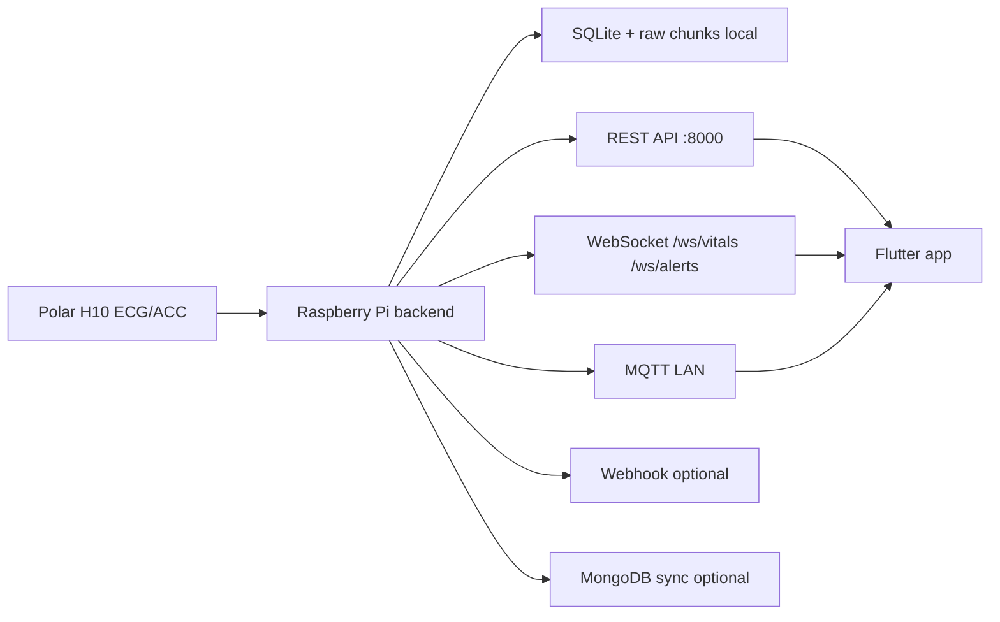

# ElderlyCareModel

Backend Edge AI cho he thong theo doi suc khoe nguoi cao tuoi bang Polar H10 ECG/ACC. Backend chay tren Raspberry Pi, xu ly tin hieu tai cho, luu SQLite local, phat canh bao realtime cho app va dong bo cloud/MongoDB khi duoc cau hinh.

> He thong nay la cong cu theo doi/sang loc va canh bao som. Khong trinh bay nhu thiet bi chan doan y khoa doc lap.

## Kien truc hien tai



Luồng realtime chính cho caregiver là REST/WebSocket. MongoDB là kênh lưu trữ/dong bộ, không nằm trong đường cảnh báo khẩn cấp.

## Runtime production

- Raspberry Pi chạy `uvicorn src.api.pipeline:app --host 0.0.0.0 --port 8000` bằng systemd.
- `POLAR_AUTO_START=1` để tự kết nối Polar H10 sau khi Pi boot.
- ECG lưu local vào SQLite và raw chunk BLOB.
- Cảnh báo high/critical được lưu bền vững trước, sau đó broadcast qua `/ws/alerts`.
- Webhook chỉ chạy khi `ALERT_WEBHOOK_URL` được cấu hình.
- Wi-Fi provisioning dùng AP `ElderlyCare-Setup-XXXX` khi Pi không vào được Wi-Fi đã lưu.

## Model đang dùng

| Thành phần | Trạng thái | Ghi chú |
|---|---|---|
| Rhythm feature model | Production chính | `models/rhythm/rhythm_feature_model.pkl` |
| Rhythm CNN 1D | Research-only | Không import trong runtime production |
| PVC/PAC ectopy | Screening phụ | `models/ectopy/` |
| Stress | Screening phụ | Cần rolling RR khoảng 300 giây |
| Global anomaly legacy | Screening phụ | Bật mặc định, có signal-quality gate |
| Patient-specific anomaly calibration | Tắt mặc định | Chỉ bật khi baseline đã được kiểm tra |

Dependency quan trọng: artifact hiện tại yêu cầu `scikit-learn==1.8.0`.

## Dữ liệu lớn không commit

Một số thư mục được loại khỏi Git vì chứa dataset lớn hoặc dữ liệu cá nhân:

```text
dataset/realtime_logs/
dataset/collected/
data_raw/
```

Tải lại từ Google Drive của dự án khi cần:

- https://drive.google.com/drive/folders/1MxtozBqBwf7SvtdJsg9ONMA4V-0SLR6G?usp=drive_link

Không commit dữ liệu ECG/ACC cá nhân, MongoDB URI, API key hoặc password Wi-Fi setup.

## Cài nhanh trên Raspberry Pi

```bash
cd /home/elcaprj/elderly_care
bash scripts/install_pi_production.sh
```

Script production sẽ:

- cài system packages cho Python, Bluetooth, NetworkManager, Wi-Fi AP, Mosquitto, SQLite;
- tạo/cập nhật `.venv`;
- cài `requirements.txt`;
- tạo/cập nhật `.env`;
- bật `POLAR_AUTO_START=1`;
- cài và enable `elderly-care.service`;
- cài và enable `elderly-care-wifi-provisioner.service`;
- smoke test `/health`.

Cấu hình Polar MAC và MongoDB ngay khi cài:

```bash
POLAR_H10_MAC=24:AC:AC:13:EB:86 \
MONGODB_SYNC_ENABLED=1 \
MONGODB_URI='mongodb+srv://...' \
bash scripts/install_pi_production.sh
```

Sau khi cài xong:

```bash
curl -s http://127.0.0.1:8000/health | python3 -m json.tool
sudo systemctl status elderly-care --no-pager
sudo systemctl status elderly-care-wifi-provisioner --no-pager
```

## Cài thủ công cho dev

```bash
python -m venv .venv
.venv\Scripts\activate  # Windows PowerShell
pip install -r requirements.txt
uvicorn src.api.pipeline:app --reload
```

Linux/Raspberry:

```bash
python3 -m venv .venv
source .venv/bin/activate
pip install -r requirements.txt
uvicorn src.api.pipeline:app --host 0.0.0.0 --port 8000
```

Dashboard dev:

```text
http://127.0.0.1:8000/dashboard
```

## Endpoint công khai/chính

Health và realtime:

- `GET /health`
- `GET /latest-result`
- `GET /latest-ecg`
- `GET /history?patient_id=&days=&limit=`
- `GET /events?patient_id=&days=&limit=`
- `GET /health-report?patient_id=&daily_hours=&long_term_days=`
- `GET /risk-summary?patient_id=&days=`

Urgent alerts cho caregiver:

- `GET /alerts/realtime?patient_id=&limit=&include_acknowledged=false`
- `WS /ws/alerts?patient_id=&caregiver_id=&api_key=`
- `POST /alerts/{event_id}/ack`
- `POST /alerts/{event_id}/resolve`

WebSocket sinh hiệu:

- `WS /ws/vitals`

Polar:

- `POST /polar/start`
- `POST /polar/stop`

Storage/sync:

- `GET /storage/status`
- `POST /storage/sync-mongodb`
- `GET /storage/sync-scheduler/status`
- `POST /storage/sync-scheduler/start`
- `POST /storage/sync-scheduler/stop`
- `POST /storage/sync-scheduler/run-once`

Baseline/calibration:

- `POST /personal-baseline/update-progressive`
- `GET /personal-baseline/status`
- `GET /guided-baseline/status`
- `POST /guided-baseline/start`
- `POST /guided-baseline/segment/complete`
- `POST /guided-baseline/complete-day`

Ingest thủ công:

- `POST /ingest-ecg`

## Auth

Trong `.env`:

```env
API_AUTH_ENABLED=1
API_KEY=<secret>
API_PUBLIC_PATHS=/health,/dashboard
ALLOWED_ORIGINS=*
```

Khi auth bật, client gửi:

- HTTP: `X-API-Key: <secret>`
- WebSocket: query `?api_key=<secret>` hoặc header `X-API-Key`.

## Wi-Fi provisioning

Nếu Raspberry không vào được Wi-Fi đã lưu, service `elderly-care-wifi-provisioner.service` có thể phát AP:

```text
SSID: ElderlyCare-Setup-XXXX
Portal: http://10.42.0.1
```

Portal/API:

- `GET /api/status`
- `GET /api/wifi/scan`
- `POST /api/wifi/connect`

Trạng thái provisioning được backend trả trong `/health.network_provisioning`.

Xem chi tiết: `docs/wifi-provisioning-production.md`.

## Train/evaluate model

```bash
python -m src.training.train_stress_wesad --wesad-root data_raw/wesad
python -m src.training.train_anomaly_legacy
python -m src.training.train_rhythm_features --dataset-dir data_processed/rhythm --model-dir models/rhythm
python -m src.training.tune_rhythm_thresholds --dataset-dir data_processed/rhythm --model-dir models/rhythm --metrics-dir models/metrics --target-recall 0.90 --precision-floor 0.80 --apply
python -m src.dataset_builders.build_mitdb_ectopy --input-dir data_raw/mitdb --output-dir data_processed/mitdb_ectopy
python -m src.training.train_ectopy_features --dataset-dir data_processed/mitdb_ectopy --model-dir models/ectopy --metrics-dir models/metrics
```

Research-only CNN:

```bash
pip install -r requirements-research.txt
python -m src.training.train_rhythm_cnn --dataset-dir data_processed/rhythm --model-dir models/research/rhythm_cnn --metrics-dir models/metrics --epochs 25 --batch-size 128
```

## Thu thập dữ liệu lâm sàng có kiểm soát

```powershell
python -m src.services.collect_clinical_arrhythmia_data --participant-id p001 --condition-group confirmed_afib --clinical-source doctor_confirmed --duration-minutes 60 --address 24:AC:AC:13:EB:86
```

Chỉ dùng mã participant ẩn danh. Không gán nhãn AFib cho toàn bộ phiên nếu không có Holter/12-lead ECG/bác sĩ xác nhận theo khoảng thời gian.

## Tài liệu liên quan

- `docs/deploy-raspberry-pi.md`: triển khai Raspberry production.
- `docs/wifi-provisioning-production.md`: Wi-Fi AP/captive portal.
- `docs/model-storage-alert-system.md`: model, storage, alert flow.
- `docs/model-training-results-report.md`: kết quả train/evaluate.
- `docs/clinical-arrhythmia-collection.md`: quy trình thu dữ liệu lâm sàng.
- `MODEL_NOTES.md`: contract backend quan trọng cho app.
