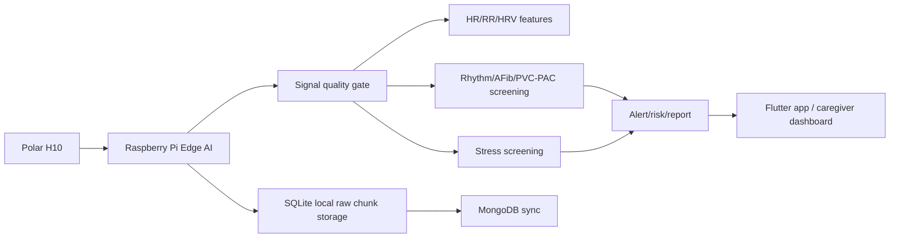

# Bao Cao Chat Luong Y Khoa Cua Polar H10 Khi Su Dung Tren Benh Nhan

## 1. Muc dich bao cao

Tai lieu nay danh gia muc do tin cay cua cam bien Polar H10 khi duoc dung trong he thong Elderly Care de thu thap ECG/HR/RR/ACC tren nguoi cao tuoi hoac benh nhan tim mach.

Muc tieu khong phai la khang dinh Polar H10 co the thay the thiet bi y te nhu ECG 12 chuyen dao, Holter ECG hoac may monitor benh vien. Muc tieu la xac dinh:

- nhung thong so nao tu Polar H10 co do tin cay cao;
- nhung thong so nao chi nen dung de sang loc/xu huong;
- dieu kien nao lam giam chat luong tin hieu;
- vi sao du an co the dung Polar H10 cho giam sat lien tuc tai nha;
- gioi han y khoa can ghi ro trong bao cao va ung dung.

Ket luan ngan gon: Polar H10 la thiet bi phu hop de thu thap nhip tim, RR interval va ECG mot kenh dang wearable trong bai toan giam sat/sang loc. Tuy nhien, ket qua dau ra cua he thong chi nen duoc trinh bay la canh bao nguy co, nghi ngo bat thuong hoac khuyen nghi theo doi/di kham, khong phai chan doan y khoa chac chan.

## 2. Co so ky thuat cua Polar H10

Polar H10 la day deo nguc do tin hieu dien hoc gan tim, khac voi smartwatch do quang hoc PPG o co tay. Ve mat ky thuat, cach do bang dien cuc tren nguc thuong on dinh hon PPG trong viec bat nhip tim va RR interval, vi tin hieu lien quan truc tiep den hoat dong dien tim.

Theo tai lieu Polar BLE SDK chinh thuc, Polar H10 cung cap:

- Heart rate va RR interval qua BLE Heart Rate Service.
- ECG data don vi microvolt voi sample rate 130 Hz.
- Accelerometer data voi cac muc sample rate 25 Hz, 50 Hz, 100 Hz, 200 Hz va don vi mG.

Trong du an nay, Polar H10 duoc dung de:

- thu ECG realtime o 130 Hz;
- thu ACC de nhan dien van dong, ho tro fall detection va suppress false alert;
- tinh HR/RR/HRV;
- phat hien tin hieu kem truoc khi chay model;
- tao input cho rhythm, AFib suspicion, PVC/PAC, stress va daily health assessment.

## 3. Bang danh gia do tin cay theo thong so

| Thong so | Muc do tin cay khi tin hieu tot | Cach dung trong du an | Luu y y khoa |
|---|---:|---|---|
| Heart rate | Cao | Hien thi realtime, tachycardia/bradycardia, trend theo ngay | Can loai bo artifact khi day deo long/nhieu |
| RR interval | Cao | HRV, stress, rhythm feature, AF episode logic | Tin cay phu thuoc chat luong QRS va tiep xuc dien cuc |
| HRV time-domain: SDNN, RMSSD, pNN50 | Kha cao trong cua so on dinh | Stress/risk trend, baseline ca nhan | Nen doc theo xu huong, khong ket luan benh rieng le |
| LF/HF | Trung binh | Feature bo sung cho stress/HRV | Nhay voi do dai window, nhieu, artifact va cach tien xu ly |
| Raw ECG 130 Hz | Trung binh-kha cho sang loc rhythm | Rhythm/ectopy/anomaly screening | Khong tuong duong ECG 12 chuyen dao; khong du de chan doan y khoa doc lap |
| ACC | Cao cho van dong co ban | REST/WALK/ACTIVE, fall candidate, context HR | Khong thay the cam bien te nga y te da duoc chung nhan |
| AFib/PVC/PAC output tu model | Phu thuoc model va chat luong tin hieu | Canh bao nghi ngo, khuyen nghi di kham neu lap lai | Can xac nhan bang ECG/Holter/bac si |

## 4. Bang chung validation tu tai lieu va nghien cuu

### 4.1. Tai lieu chinh thuc Polar H10

White paper cua Polar mo ta H10/Pro Strap la the he do nhip tim bang day deo nguc, duoc thiet ke de bat QRS va tinh HR/RR trong dieu kien van dong. Trong phan ket qua, tai lieu bao cao ty le RR interval nam trong sai so 2 ms la 92.9% khi chay, 99.3% khi dap xe, 95.3% khi tap ta va 95.6% tren tong hop cac hoat dong. Tai lieu cung nhan manh cac yeu to anh huong chat luong nhu do ap sat day deo, nhieu dien, tiep xuc dien cuc va xu ly QRS.

Danh gia cho du an:

- Day la nguon tu nha san xuat, nen khong nen dung nhu bang chung doc lap duy nhat.
- Gia tri thuc te cua white paper la giai thich co so ky thuat va dieu kien tao ra tin hieu tot.
- Cac con so RR trong white paper ung ho viec dung Polar H10 cho HR/RR/HRV khi day deo dung cach.

### 4.2. Nghien cuu HRV so voi ECG chuan

Nghien cuu Sensors 2022 so sanh Polar H10 voi ECG 12 chuyen dao tren 25 nguoi tham gia trong dieu kien nghi va dap xe tang dan cuong do. Ket qua cho thay HR/RR va cac chi so HRV tu Polar H10 co muc tuong dong cao voi ECG chuan, dac biet voi cac bien tuyen tinh. Tac gia bao cao he so tuong quan/ICC cao o dieu kien nghi va van dong; voi RR/HR, sai lech Bland-Altman nho. Nghien cuu ket luan cac phep do HRV tuyen tinh tu Polar H10 co the duoc khuyen nghi cho nguoi thuc hanh trong dieu kien phu hop.

Gioi han quan trong:

- Mau nghien cuu chu yeu la nguoi truong thanh khoe manh, khong phai benh nhan cao tuoi.
- Mot so chi so phi tuyen nhu DFA a1 co sai lech lon hon, dac biet khi cuong do cao.
- Tac gia khuyen nghi nen quan sat waveform ban dau va toi uu vi tri day deo khi can do chinh xac.

Danh gia cho du an:

- Cac feature HRV dang dung trong he thong nhu RR_mean, SDNN, RMSSD, pNN50 co co so tin cay hon so voi feature phi tuyen phuc tap.
- LF/HF va cac dien giai stress tu HRV nen duoc xem la chi bao bo sung, khong phai ket luan y khoa doc lap.

### 4.3. Nghien cuu tren benh nhan tim so voi Holter

Pilot study trong Europace 2023 danh gia Polar H10 va Fitbit Inspire 2 so voi Holter 24 gio tren 15 benh nhan: 5 rung nhi, 5 suy tim, 5 sau phuc hoi chuc nang tim. Ket qua voi Polar H10 raw HR data cho thay tuong quan manh voi Holter, r = 0.932, MAE = 3.43 bpm va MAPE = 4.86%. Sau xu ly artifact, do chinh xac cai thien nhe. Tac gia ket luan Polar H10 rat chinh xac trong do HR 24 gio so voi Holter, nhung ket qua co khac nhau theo nhom benh nhan va can xu ly artifact.

Danh gia cho du an:

- Day la bang chung lien quan truc tiep hon voi nhom nguoi benh tim.
- Ket qua ung ho viec dung Polar H10 de theo doi HR lien tuc tren benh nhan.
- Tuy nhien, day chi la pilot study voi so mau nho; khong du de khang dinh kha nang chan doan rung nhi/PVC/PAC thay Holter.

## 5. Muc do tin cay khi su dung tren benh nhan

### 5.1. Nhung diem co the tin tuong

Polar H10 co the duoc tin tuong tuong doi cao trong cac muc sau:

1. Do nhip tim lien tuc khi day deo ap sat va dien cuc du am.
2. Tao chuoi RR interval co ich cho HRV va theo doi xu huong sinh ly.
3. Ho tro giam sat 24 gio hoac nhieu ngay neu ket noi BLE on dinh va co co che luu tru local.
4. Cho phep phat hien tin hieu kem bang cac chi so nhu R-peak count, RR outlier ratio, amplitude variance, beat-template correlation.
5. Ket hop ACC de biet boi canh van dong, giup giam nham lan giua stress/HR cao do van dong va bat thuong sinh ly.

### 5.2. Nhung diem khong nen khang dinh qua muc

Khong nen ghi Polar H10 hoac model cua du an co kha nang:

- chan doan rung nhi chac chan;
- thay the Holter ECG;
- thay the ECG 12 chuyen dao;
- phat hien moi loai benh tim;
- dua ra ket luan dieu tri;
- dam bao khong bo sot bat thuong tim.

Ly do:

- Polar H10 chi la mot nguon tin hieu wearable, khong phai he thong ECG y te day du.
- Raw ECG tu BLE o 130 Hz thap hon nhieu thiet bi ECG y te chuan.
- Vi tri dien cuc day deo nguc khac voi chuyen dao ECG tieu chuan.
- Artifact do day deo long, kho da, mo hoi, chuyen dong va mat goi BLE co the lam sai R-peak/RR.
- Model AI cua du an duoc train tren dataset cong khai va du lieu thuc nghiem han che, chua phai clinical validation.

## 6. Anh huong cua chat luong tin hieu

Chat luong tin hieu la dieu kien bat buoc truoc khi tin vao dau ra model. Mot cua so ECG nen duoc xem la khong dang tin neu co cac dau hieu:

- sample qua it hoac mat goi BLE;
- tin hieu phang, zero ratio cao, NaN;
- bien do qua thap hoac qua bat thuong;
- R-peak qua it hoac qua day;
- RR outlier ratio cao;
- QRS/R-peak candidates qua hep, co the la nhieu;
- beat-template correlation thap;
- HR tu RR khong phu hop voi boi canh ACC.

Trong he thong, neu signal quality la poor, cac model rhythm, stress, ectopy, anomaly nen tra `unknown` hoac `skipped`, thay vi ep du doan. Day la quyet dinh quan trong de tang do an toan y khoa.

## 7. Cach trinh bay ket qua cho nguoi dung

Nen dung cac cum tu an toan:

- "Co dau hieu nghi ngo bat thuong nhip tim."
- "Nen tiep tuc theo doi va di kham neu tinh trang lap lai."
- "Tin hieu dang kem, hay kiem tra day deo Polar H10."
- "Ket qua chi co gia tri sang loc, khong thay the chan doan y khoa."

Khong nen dung:

- "Ban bi rung nhi."
- "Ban bi benh tim."
- "Ket qua chan doan chinh xac."
- "Khong co bat thuong" neu du lieu thieu hoac tin hieu kem.

De phu hop y khoa, dashboard/app nen hien thi:

- signal quality;
- thoi gian du lieu hop le;
- muc tin cay/confidence;
- ly do canh bao;
- khuyen nghi hanh dong;
- disclaimer ro rang.

## 8. Y nghia voi kien truc Elderly Care

Polar H10 phu hop voi du an vi:

- Do duoc tin hieu gan tim truc tiep hon smartwatch PPG.
- Co RR interval va ECG raw, phu hop voi rhythm/HRV model.
- Co ACC, giup bo sung ngu canh van dong va fall detection.
- Nho gon, gia thap hon Holter, co the dung tai nha.
- Co BLE SDK va stream realtime cho Raspberry Pi.

Vi vay, kien truc hop ly la:

Trong luong nay, Polar H10 la thiet bi thu tin hieu, con y nghia y khoa phai duoc quyet dinh boi:

- tien xu ly va loc nhieu;
- signal quality gate;
- model da validation;
- daily/long-term assessment;
- ngu canh cua nguoi dung;
- xac nhan sau do bang bac si/ECG/Holter neu can.

## 9. Ket luan dua vao bao cao do an

Polar H10 co co so ky thuat va bang chung nghien cuu du manh de duoc su dung nhu mot cam bien wearable cho giam sat nhip tim, RR interval va HRV trong he thong sang loc suc khoe tai nha. Cac nghien cuu so voi ECG/Holter cho thay HR/RR cua Polar H10 co do tuong dong cao khi tin hieu tot, ke ca co bang chung pilot tren nhom benh nhan tim mach.

Tuy nhien, chat luong y khoa cua toan he thong khong chi phu thuoc Polar H10. He thong phai co kiem tra chat luong tin hieu, luu tru raw data, xu ly artifact, logic canh bao an toan va cach trinh bay ket qua dung muc. Trong du an Elderly Care, Polar H10 nen duoc xem la nguon du lieu tin cay cho theo doi va sang loc, con cac canh bao AFib/PVC/PAC/stress/anomaly chi la dau hieu nghi ngo de nguoi dung tiep tuc theo doi hoac di kham, khong phai chan doan cuoi cung.

## 10. Nguon tham khao

1. Polar BLE SDK - Polar H10 product documentation: https://github.com/polarofficial/polar-ble-sdk/blob/master/documentation/products/PolarH10.md
2. Polar Electro. Polar H10 Heart Rate Sensor System White Paper, 2019: https://www.polar.com/img/static/whitepapers/pdf/polar-h10-heart-rate-sensor-white-paper.pdf
3. Schaffarczyk M. et al. "Validity of the Polar H10 Sensor for Heart Rate Variability Analysis during Resting State and Incremental Exercise in Recreational Men and Women." Sensors, 2022: https://www.mdpi.com/1424-8220/22/17/6536
4. Vermunicht P. et al. "Validation of Polar H10 chest strap and Fitbit Inspire 2 tracker for measuring continuous heart rate in cardiac patients: impact of artefact removal algorithm." Europace Supplement, 2023: https://academic.oup.com/europace/article/25/Supplement_1/euad122.550/7176633
