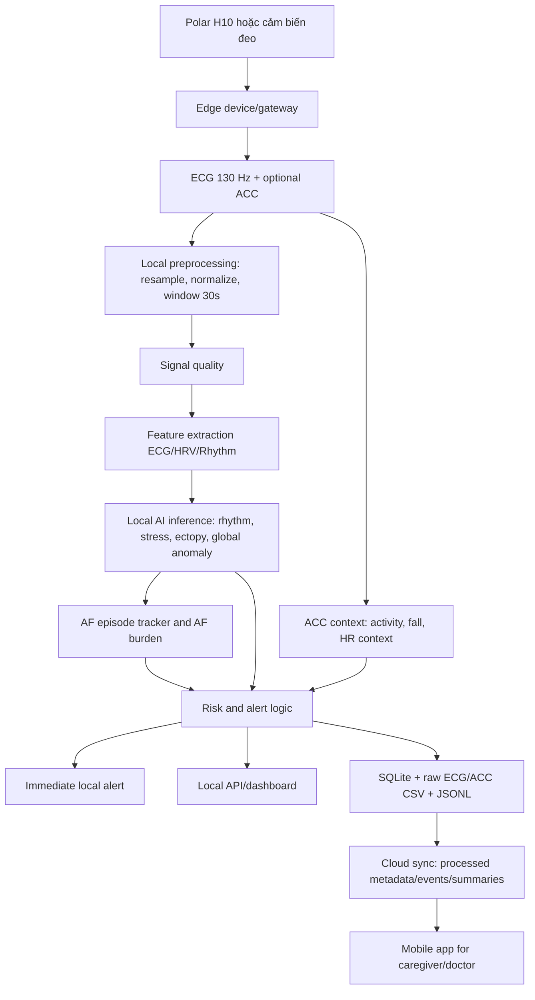

# Báo cáo tổng hợp hệ thống Elderly Care ECG

Ngày tổng hợp: 2026-06-05
Phạm vi: mã nguồn Python trong dự án `elderly_care-amine`, dữ liệu xử lý, model đã huấn luyện và các tài liệu hiện có trong `docs/`, `models/`, `src/`.

### Cập nhật runtime 2026-06-05

- Public API hiện dùng `stress`, không dùng `emotion` làm output chính.
- Rhythm feature model là model production cho realtime; CNN rhythm chỉ giữ trong research/comparison.
- Global anomaly legacy đang bật mặc định với signal-quality gate; patient-specific anomaly calibration tắt mặc định và chỉ bật khi `ANOMALY_CALIBRATION_ENABLED=1`.
- Raspberry runtime cần `scikit-learn==1.8.0` để load đúng rhythm/ectopy/anomaly pickle artifacts.

## 1. Tóm tắt dự án

Dự án xây dựng một hệ thống Edge AI theo dõi sức khỏe người cao tuổi dựa trên tín hiệu sinh lý từ thiết bị đeo, trọng tâm hiện tại là ECG từ Polar H10 và ngữ cảnh vận động từ ACC. Điểm cốt lõi của đề tài là xử lý dữ liệu tại biên, tức là dữ liệu được thu nhận, tiền xử lý, trích xuất đặc trưng, suy luận model và tạo cảnh báo ngay tại thiết bị cục bộ hoặc gateway gần người dùng, không phụ thuộc hoàn toàn vào cloud để ra quyết định tức thời.

Hệ thống nhận dữ liệu ECG theo cửa sổ thời gian, đánh giá chất lượng tín hiệu, trích xuất đặc trưng tim mạch, dự đoán nhịp tim/AFib, ước lượng stress, phát hiện bất thường ECG, nhận diện vận động và phát hiện ngã theo luật. Kết quả được tổng hợp thành mức cảnh báo tại thời điểm đo, có thể phát tín hiệu cảnh báo ngay tại chỗ cho người dùng/người chăm sóc, đồng thời lưu cục bộ vào SQLite/CSV. Sau đó, dữ liệu đã xử lý như prediction metadata, event timeline, session summary và risk summary được đồng bộ lên cloud để ứng dụng điện thoại có thể hiển thị lịch sử, cảnh báo và trạng thái sức khỏe từ xa.

Hướng phát triển chính hiện tại là chuyển từ model anomaly cũ sang pipeline nhịp tim rõ ràng hơn:

```text
Polar H10 ECG/RR/ACC
-> xử lý tại thiết bị biên hoặc gateway cục bộ
-> đánh giá chất lượng tín hiệu
-> phân loại nhịp ECG
-> theo dõi cơn AF
-> tính AF burden
-> cảnh báo tức thời tại chỗ
-> đồng bộ kết quả đã xử lý lên cloud/app điện thoại
```

Hệ thống nên được mô tả là công cụ hỗ trợ sàng lọc, theo dõi và cảnh báo sớm, chưa phải công cụ chẩn đoán y khoa độc lập. Người dùng cuối, đặc biệt là người cao tuổi, vẫn cần bác sĩ hoặc nhân viên y tế xác nhận khi hệ thống phát hiện dấu hiệu bất thường.

## 2. Mục tiêu và ý nghĩa xã hội

Người cao tuổi là nhóm có nhu cầu theo dõi sức khỏe liên tục vì rủi ro bệnh tim mạch, rối loạn nhịp, ngã, giảm khả năng tự chăm sóc và nguy cơ không được phát hiện kịp thời khi sống một mình. Theo WHO, đến năm 2030, cứ 6 người trên thế giới sẽ có 1 người từ 60 tuổi trở lên; đến năm 2050, số người từ 60 tuổi trở lên dự kiến đạt khoảng 2,1 tỷ người. Điều này làm tăng nhu cầu về chăm sóc dài hạn, theo dõi từ xa và hệ thống cảnh báo sớm.

AFib là một rối loạn nhịp quan trọng ở người lớn tuổi. CDC nêu rằng nguy cơ AFib tăng theo tuổi, AFib liên quan đến nguy cơ đột quỵ cao hơn và có thể không có triệu chứng rõ ràng ở một số người. Vì vậy, theo dõi nhịp tim liên tục bằng thiết bị đeo có ý nghĩa thực tiễn: nó giúp phát hiện các đoạn nghi ngờ, tạo lịch sử theo dõi và hỗ trợ quyết định đi khám.

Ngã cũng là nguy cơ lớn với người cao tuổi. CDC ghi nhận hơn 1/4 người từ 65 tuổi trở lên bị ngã mỗi năm, và một phần các ca ngã dẫn đến chấn thương cần chăm sóc y tế hoặc hạn chế sinh hoạt. Vì vậy, tích hợp ACC để nhận diện hoạt động và phát hiện ngã giúp hệ thống không chỉ nhìn vào ECG mà còn hiểu hoàn cảnh thực tế của người dùng.

Mục đích cấp thiết của phần model trong dự án:

- Giảm thời gian phát hiện dấu hiệu bất thường: hệ thống có thể ghi nhận nhịp bất thường, xác suất AFib, nhịp tim quá cao/thấp và ngã trong các cửa sổ 30 giây.
- Phát cảnh báo ngay tại thời điểm xảy ra sự kiện: vì suy luận chạy tại biên, thiết bị/gateway có thể cảnh báo tại chỗ ngay cả khi kết nối mạng không ổn định.
- Hỗ trợ người cao tuổi sống độc lập hơn: người thân hoặc người chăm sóc có thêm dữ liệu khách quan thay vì chỉ dựa vào cảm nhận chủ quan.
- Giảm cảnh báo sai do vận động: ACC giúp phân biệt tăng nhịp tim do đi bộ/hoạt động với tăng nhịp khi nghỉ.
- Tạo dữ liệu theo dõi dài hạn: AF burden, sự kiện nhịp, chất lượng tín hiệu và lịch sử cảnh báo có giá trị hơn một dự đoán đơn lẻ.
- Là nền tảng cho chăm sóc từ xa: dữ liệu thô và suy luận được xử lý cục bộ, còn dữ liệu sau xử lý được gửi lên cloud để ứng dụng điện thoại của người nhà/bác sĩ theo dõi.

## 3. Kiến trúc hệ thống



### 3.1 Luồng realtime tại biên

1. Nguồn dữ liệu đi vào từ endpoint `POST /ingest-ecg` hoặc collector BLE Polar H10.
2. Dữ liệu được xử lý ngay trên thiết bị biên/gateway cục bộ: kiểm tra đầu vào, đánh giá chất lượng tín hiệu, lọc, phát hiện R-peak, tính RR interval và trích xuất đặc trưng.
3. Model rhythm chạy tại chỗ để dự đoán nhãn nhịp và xác suất `possible_afib`.
4. Tracker AF episode tại biên theo dõi các cửa sổ liên tiếp để xác định cơn AF và AF burden.
5. Stress model, PVC/PAC ectopy model và global anomaly legacy chạy tại chỗ; anomaly calibration cá nhân chỉ bật khi được cấu hình riêng.
6. Nếu có ACC, hệ thống phân loại hoạt động, phát hiện ngã và sinh cảnh báo HR theo hoạt động.
7. Alert engine kết hợp rhythm, HR event, anomaly, stress, risk trend, fall và signal quality thành `alert_level`.
8. Khi phát hiện bất thường, thiết bị/gateway có thể phát cảnh báo ngay tại thời điểm đó, ví dụ âm thanh, rung, đèn cảnh báo, notification nội bộ hoặc tín hiệu gửi sang app cục bộ.
9. Kết quả được lưu vào SQLite, raw ECG/ACC CSV, JSONL và hiển thị dashboard local.
10. Cloud chỉ nhận dữ liệu đã xử lý như prediction metadata, sự kiện, risk summary và session summary để gửi đến ứng dụng điện thoại. Điều này giúp giảm băng thông, bảo vệ dữ liệu thô tốt hơn và vẫn giữ được cảnh báo tức thời khi mất mạng.

### 3.2 Các tầng chính

- Tầng thu thập dữ liệu tại biên: BLE Polar H10, API HTTP, ECG/ACC stream.
- Tầng xử lý tại chỗ: chuẩn hóa tần số mẫu, chuẩn hóa biên độ, chia cửa sổ 30 giây.
- Tầng trích xuất đặc trưng tại biên: HRV, hình thái ECG, phổ, đặc trưng nhịp, đặc trưng gia tốc.
- Tầng Edge AI inference: rhythm feature model, stress model, PVC/PAC ectopy model và global anomaly legacy chạy cục bộ.
- Tầng rule engine/cảnh báo tức thời: chất lượng tín hiệu, HR event, fall, risk, alert.
- Tầng lưu trữ cục bộ: SQLite, CSV, JSONL để hệ thống vẫn hoạt động khi không có Internet.
- Tầng đồng bộ cloud/mobile: MongoDB hoặc cloud backend nhận dữ liệu đã xử lý để gửi đến ứng dụng điện thoại.
- Tầng giao diện: FastAPI dashboard HTML tại local và ứng dụng điện thoại ở phía người chăm sóc.

## 4. Nhiệm vụ của từng file và thư mục chính

### 4.1 File gốc

| File/thư mục | Nhiệm vụ |
|---|---|
| `README.md` | Hướng dẫn cài dependency, train model, chạy API, dashboard, MongoDB sync. |
| `pipeline.py` | Wrapper tương thích, import toàn bộ từ `src.api.pipeline`; dùng để chạy `uvicorn pipeline:app --reload` hoặc `python pipeline.py --bluetooth-demo`. |
| `mission.md` | Tài liệu định hướng/roadmap dự án. |
| `requirements.txt` | Danh sách thư viện: numpy, scipy, pandas, scikit-learn, FastAPI, bleak, wfdb, pymongo... |
| `docs/` | Tài liệu kỹ thuật, kế hoạch tích hợp ACC, workflow rebuild rhythm. |
| `models/` | Model đã huấn luyện, scaler, schema feature, metrics và decision config. |
| `data_raw/` | Dữ liệu gốc: WESAD, CinC 2017, AFDB, NSTDB, real_data, MITDB... |
| `data_processed/` | Dữ liệu đã xử lý thành cửa sổ `.npy`, metadata, summary, evaluation output. |
| `dataset/realtime_logs/` | Log vận hành realtime: SQLite, raw ECG/ACC CSV, JSONL. |
| `legacy/` | Notebook/script cũ để tham khảo, không phải luồng phát triển chính. |
| `tests/` | Unit tests cho ECG features, ACC features, rhythm rebuild, MongoDB sync. |

### 4.2 `src/preprocessing.py`

File lõi cho tiền xử lý ECG và nhãn rhythm:

- `TARGET_SAMPLE_RATE_HZ = 130`, `WINDOW_SECONDS = 30`, `SAMPLES_PER_WINDOW = 3900`.
- `resample_ecg`: đổi tần số mẫu bằng `scipy.signal.resample_poly`.
- `normalize_ecg`: trừ median, chia theo IQR hoặc độ lệch chuẩn.
- `pad_or_crop_window`: đảm bảo mỗi cửa sổ có đúng 3900 mẫu.
- `split_into_windows`: chia tín hiệu thành các cửa sổ cố định.
- `encode_rhythm_label`: map nhãn CinC 2017 `N`, `A`, `O`, `~` sang `normal`, `possible_afib`, `other_rhythm`, `noise`.

### 4.3 `src/features/ecg_features.py`

Phụ trách xử lý ECG truyền thống:

- Lọc bandpass Butterworth bậc 2 từ 5-40 Hz.
- Phát hiện R-peak bằng `scipy.signal.find_peaks`.
- Tính RR interval theo ms.
- Trích xuất HRV/RR cho stress và anomaly screening: `RR_mean`, `mean_HR`, `SDNN`, `RMSSD`, `pNN50`, `LF/HF`, `CVRR`.
- Đánh giá chất lượng tín hiệu: thời lượng, NaN, zero ratio, biên độ, số R-peak, tỷ lệ RR hợp lệ, outlier RR.
- Trích xuất đặc trưng hình thái nhịp tim: biên độ beat, năng lượng beat, slope QRS.
- Tạo matrix feature đúng schema cho model.

### 4.4 `src/features/rhythm_features.py`

Trích xuất 41 đặc trưng cho model phân loại nhịp:

- Nhóm R-peak/RR: số peak, RR count, HR trung bình/trung vị/min/max, `rmssd`, `sdnn`, `pnn50`, irregularity index, outlier ratio.
- Nhóm entropy và hình dạng chuỗi RR: sample entropy, turning point ratio.
- Nhóm QRS/R amplitude: width mean/std, amplitude mean/std.
- Nhóm thống kê ECG: mean, std, IQR, range, skewness, kurtosis, energy, line length, zero crossing rate.
- Nhóm phổ: spectral entropy, high-frequency power ratio.
- Nhóm quality: `signal_quality_score`.

### 4.5 `src/features/acc_features.py`

Phụ trách dữ liệu gia tốc ACC từ Polar H10:

- `parse_acc_packet`: parse gói Polar PMD ACC type `0x02`, hỗ trợ frame 8/16/24-bit.
- `normalize_acc_samples`: đưa ACC về ma trận Nx4 gồm `x_mg`, `y_mg`, `z_mg`, `vm_mg`.
- `classify_activity`: phân loại `REST`, `SLOW_WALK`, `WALK`, `ACTIVE` theo độ lệch chuẩn vector magnitude.
- `detect_fall`: phát hiện ngã theo chuỗi điều kiện impact, free-fall, post-still.
- `context_hr_alert`: đánh giá nhịp tim theo ngữ cảnh hoạt động.
- `summarize_acc_window`: gom activity, fall và HR context thành `sensor_context`.

### 4.6 `src/inference/`

| File | Nhiệm vụ |
|---|---|
| `rhythm_inference.py` | Load rhythm model/scaler/schema/label map, chuẩn hóa ECG, chia cửa sổ, trích xuất 41 features và trả nhãn rhythm + xác suất. |
| `af_episode_tracker.py` | Theo dõi cơn AF qua nhiều cửa sổ, yêu cầu số cửa sổ liên tiếp tối thiểu, tính AF burden. |
| `alert_engine.py` | Map rhythm, xác suất AFib, HR event, signal quality và activity thành cảnh báo `normal`, `medium`, `high`, `unknown`. |
| `hr_event.py` | Rule phát hiện `tachycardia_at_rest`, `bradycardia`, `normal_hr`, `unknown`. |

### 4.7 `src/api/pipeline.py`

File trung tâm của hệ thống realtime:

- Khởi tạo FastAPI và dashboard.
- Load model stress, rhythm, ectopy, global anomaly legacy và decision config.
- Cấu hình BLE Polar H10: HR UUID, PMD_CONTROL, PMD_DATA, ECG/ACC start/stop command.
- `predict_ecg`: hàm inference chính, kết hợp signal quality, stress, anomaly, rhythm, ectopy, AF episode, HR event, ACC context, risk và alert.
- API endpoints:
  - `GET /health`
  - `GET /dashboard`
  - `GET /latest-result`
  - `GET /latest-ecg`
  - `GET /history`
  - `GET /risk-summary`
  - `GET /session-summary`
  - `GET /events`
  - `POST /ingest-ecg`
  - `POST /polar/start`
  - `POST /polar/stop`
  - `POST /sync/mongodb`
  - `POST /baseline/mark-current-session`
  - `POST /baseline/calibrate-real-data`
  - `GET /baseline/status`
  - `POST /personal-baseline/update-progressive`
  - `POST /personal-baseline/calibrate`
  - `GET /personal-baseline/status`
- Dashboard HTML hiển thị HR, stress, anomaly, rhythm, AFib probability, AF episode, signal quality, risk, activity, fall, waveform, history và event timeline.

### 4.8 `src/training/`

| File | Nhiệm vụ |
|---|---|
| `train_rhythm_features.py` | Train rhythm feature baseline từ `data_processed/rhythm*`; thử RandomForest, ExtraTrees, HistGradientBoosting; chọn model theo score ưu tiên macro F1, AFib recall, noise recall và giảm false AFib từ noise. |
| `evaluate_long_term_afdb.py` | Đánh giá model rhythm trên AFDB dài hạn: window-level AF detection, threshold sweep, episode metrics, AF burden, tạo `rhythm_decision_config.json`. |
| `train_stress_wesad.py` | Train stress model nhị phân từ WESAD ECG chest, dùng LOSO/GroupKFold theo subject. |
| `train_anomaly_legacy.py` | Train IsolationForest anomaly legacy từ MITBIH/PTBDB, chỉ dùng dữ liệu normal để học biên bình thường. |

### 4.9 `src/dataset_builders/`

| File | Nhiệm vụ |
|---|---|
| `build_cinc2017.py` | Đọc PhysioNet/CinC 2017 `.mat/.hea/REFERENCE.csv`, resample về 130 Hz, chuẩn hóa, chia cửa sổ 30 giây, tạo `X.npy`, `y.npy`, metadata. |
| `augment_rhythm_with_nstdb.py` | Trộn nhiễu MIT-BIH NSTDB `bw`, `em`, `ma` vào cửa sổ sạch ở các mức SNR để tăng class `noise`. |
| `build_afdb.py` | Đọc MIT-BIH AFDB bằng `wfdb`, tạo cửa sổ 30 giây, gán AF nếu tỷ lệ AF trong cửa sổ >= 0.5, lưu metadata episode. |
| `clean_collected_raw_data.py` | Script cũ làm sạch dữ liệu collected/raw và gán nhãn stress theo tên file hoặc đoạn đặc biệt. |

### 4.10 `src/storage/`

| File | Nhiệm vụ |
|---|---|
| `ecg_storage.py` | SQLite schema `predictions`, migration cột mới, lưu raw ECG/ACC CSV, đọc history, latest ECG, session summary, risk summary, event timeline. |
| `mongodb_sync.py` | Đồng bộ dữ liệu đã xử lý như metadata dự đoán, events, session summaries, risk summaries sang MongoDB/cloud backend để ứng dụng điện thoại đọc. Raw ECG/ACC mặc định chỉ lưu đường dẫn để tránh payload lớn. |

### 4.11 `src/services/`

| File | Nhiệm vụ |
|---|---|
| `collect_real_data.py` | Thu thập session thực tế từ Polar H10: ECG 130 Hz, ACC 25/50/100/200 Hz, HR/RR nếu có; lưu `ecg.csv`, `acc.csv`, `rr.csv`, `metadata.json`. |

### 4.12 `src/evaluation/`

| File | Nhiệm vụ |
|---|---|
| `evaluate_real_data.py` | Chạy pipeline trên `data_raw/real_data` theo cửa sổ 30 giây, xuất `predictions.csv`, `events.csv`, `summary.json`, `events.json`. |

### 4.13 `src/calibration/`

| File | Nhiệm vụ |
|---|---|
| `anomaly_calibration.py` | Huấn luyện anomaly model cá nhân hóa từ session baseline hoặc real_data trạng thái nghỉ, lưu model/scaler/metadata riêng theo patient. |
| `personal_baseline.py` | Tạo baseline cá nhân lũy tiến tối đa 7 ngày từ SQLite predictions; tính HR baseline, HR theo activity, AF suspicion ratio, anomaly ratio, PVC/PAC ratio và signal quality cho từng patient. |
| `calibrate_real_data.py` | CLI gọi `train_calibration_from_real_data`. |
| `calibrate_sensor_context.py` | Tính threshold runtime cho activity, fall, signal quality, rhythm alert dựa trên real_data có nhãn rest/walk/active. |

### 4.14 Model artifacts

| Artifact | Nhiệm vụ |
|---|---|
| `models/rhythm/rhythm_feature_model.pkl` | Model phân loại nhịp hiện tại, selected model là `HistGradientBoostingClassifier`. |
| `models/rhythm/rhythm_scaler.pkl` | `StandardScaler` cho 41 rhythm features. |
| `models/rhythm/rhythm_feature_schema.json` | Danh sách 41 feature bắt buộc. |
| `models/rhythm/label_map.json` | Map class id sang nhãn rhythm. |
| `models/rhythm/rhythm_decision_config.json` | Threshold deployment cho AF episode và alert. |
| `models/metrics/rhythm_feature_metrics.json` | Metric multiclass rhythm trên test split. |
| `models/metrics/afdb_long_term_metrics.json` | Metric AFDB dài hạn, threshold sweep, AF burden, episode metrics. |
| `models/stress/rf_model.pkl` | RandomForest branch của stress model WESAD. |
| `models/stress/svm_pipeline.pkl` | SVM pipeline branch của stress model WESAD. |
| `models/stress/scaler_final.pkl` | Scaler dùng cho stress features. |
| `models/stress/model_metadata.json` | Metadata stress model, label map, window seconds và metrics tóm tắt. |
| `models/stress/stress_feature_schema.json` | Schema feature của stress model. |
| `models/metrics/stress_metrics.json` | Metric stress model. |
| `models/anomaly_legacy/isolation_forest_model.pkl` | IsolationForest anomaly legacy. |
| `models/anomaly_legacy/anomaly_scaler.pkl` | Scaler anomaly legacy. |
| `models/anomaly_legacy/anomaly_feature_schema.json` | Schema 10 anomaly features. |

## 5. Cách vận hành hệ thống

### 5.1 Cài đặt

```powershell
python -m pip install -r requirements.txt
```

Nếu dùng virtual environment:

```powershell
python -m venv .venv
.\.venv\Scripts\Activate.ps1
python -m pip install -r requirements.txt
```

### 5.2 Train hoặc rebuild model

Train stress:

```powershell
python -m src.training.train_stress_wesad --wesad-root data_raw/wesad --skip-importance
```

Train anomaly legacy:

```powershell
python -m src.training.train_anomaly_legacy
```

Build dataset CinC 2017:

```powershell
python -m src.dataset_builders.build_cinc2017 `
  --input-dir data_raw/cinc2017 `
  --output-dir data_processed/rhythm
```

Augment noise bằng NSTDB:

```powershell
python -m src.dataset_builders.augment_rhythm_with_nstdb `
  --input-dir data_processed/rhythm `
  --nstdb-dir data_raw/nstdb `
  --output-dir data_processed/rhythm_nstdb_augmented `
  --augmented-count 1600
```

Train rhythm model:

```powershell
python -m src.training.train_rhythm_features `
  --dataset-dir data_processed/rhythm_nstdb_augmented `
  --model-dir models/rhythm `
  --metrics-dir models/metrics
```

Build và đánh giá AFDB:

```powershell
python -m src.dataset_builders.build_afdb `
  --input-dir data_raw/afdb `
  --output-dir data_processed/afdb_windows

python -m src.training.evaluate_long_term_afdb `
  --dataset-dir data_processed/afdb_windows `
  --model-dir models/rhythm `
  --metrics-dir models/metrics `
  --decision-mode probability_only `
  --afib-probability-threshold 0.1
```

Lưu ý: file `models/rhythm/rhythm_decision_config.json` hiện chọn `episode_threshold = 0.05`, `alert_threshold = 0.3`, `decision_mode = probability_only`. Một số tài liệu cũ trong repo còn ghi mặc định 0.1, nên khi báo cáo nên lấy theo config hiện tại.

### 5.3 Chạy API và dashboard

```powershell
uvicorn src.api.pipeline:app --reload
```

Hoặc dùng wrapper:

```powershell
uvicorn pipeline:app --reload
```

Mở dashboard:

```text
http://127.0.0.1:8000/dashboard
```

Kiểm tra health:

```text
GET http://127.0.0.1:8000/health
```

### 5.4 Gửi dữ liệu ECG qua API

Endpoint:

```http
POST /ingest-ecg
```

Body mẫu:

```json
{
  "patient_id": "chinh",
  "sample_rate_hz": 130,
  "timestamp": "2026-05-14T10:30:00+07:00",
  "ecg_samples": [943, 1076, 1210],
  "acc_sample_rate_hz": 25,
  "acc_samples": [
    {"x_mg": 1000, "y_mg": 0, "z_mg": 0}
  ]
}
```

Kết quả trả về gồm:

- `heart_rate_bpm`
- `stress`
- `anomaly`
- `rhythm`
- `hr_event`
- `af_episode`
- `rhythm_alert`
- `signal_quality`
- `risk`
- `sensor_context`
- `alert_level`
- `message`

### 5.5 Chạy Polar H10 realtime

Qua API:

```http
POST /polar/start
POST /polar/stop
```

Body start mẫu:

```json
{
  "address": "24:AC:AC:13:EB:86",
  "chunk_seconds": 30
}
```

Qua CLI:

```powershell
python pipeline.py --bluetooth-demo
```

Thu real_data có nhãn rest/walk/active:

```powershell
python -m src.services.collect_real_data `
  --person-id chinh `
  --state rest `
  --duration-seconds 330 `
  --output-root data_raw/real_data
```

### 5.6 Calibrate cá nhân hóa

Calibrate anomaly từ real_data nghỉ:

```powershell
python -m src.calibration.calibrate_real_data `
  --person-id chinh `
  --states rest `
  --contamination 0.03
```

Calibrate threshold activity/fall/signal:

```powershell
python -m src.calibration.calibrate_sensor_context `
  --input-dir data_raw/real_data `
  --person-id chinh `
  --output-path models/runtime/sensor_context_config.json
```

Cap nhat progressive personal baseline 7 ngay tu SQLite predictions:

```powershell
Invoke-RestMethod -Method Post `
  -Uri http://127.0.0.1:8000/personal-baseline/update-progressive `
  -ContentType "application/json" `
  -Body '{"patient_id":"polar_h10","target_days":7,"min_predictions":20,"include_alert_windows":false}'
```

Baseline nay khong retrain model benh ly. No tao muc nen ca nhan de so sanh HR, REST HR, AF suspicion ratio, anomaly ratio, PVC/PAC ratio va signal quality. Trang thai `not_ready`, `warming_up`, `ready` cho biet baseline da du tin cay hay chua. Khuyen nghi van hanh la goi endpoint nay moi ngay mot lan trong 7 ngay dau, sau do tiep tuc update theo rolling 7 ngay.

### 5.7 Đánh giá dữ liệu thực tế

```powershell
python -m src.evaluation.evaluate_real_data `
  --input-dir data_raw/real_data `
  --output-dir data_processed/real_data_eval `
  --person-id chinh
```

Output:

- `predictions.csv`
- `events.csv`
- `summary.json`
- `events.json`

### 5.8 Đồng bộ cloud/MongoDB cho ứng dụng điện thoại

Trong kiến trúc Edge AI, cloud không bắt buộc để tạo cảnh báo tức thời. Thiết bị biên hoặc gateway local chạy inference trước, sau đó mới gửi dữ liệu đã xử lý lên cloud. Ứng dụng điện thoại của người chăm sóc/bác sĩ đọc dữ liệu từ cloud để nhận thông báo, xem lịch sử, xem risk summary và event timeline.

Các loại dữ liệu nên đồng bộ:

- Prediction metadata: nhịp, xác suất AFib, HR, stress, anomaly, signal quality, alert level.
- Events: rhythm alert, HR event, fall candidate, signal quality issue.
- Session summaries: thống kê theo phiên đo.
- Risk summaries: điểm rủi ro theo ngày/tuần.

Raw ECG/ACC không được đẩy lên cloud mặc định để giảm băng thông và giảm rủi ro riêng tư. Khi cần phân tích chuyên sâu, hệ thống có thể đồng bộ theo quyền truy cập riêng.

Thiết lập biến môi trường:

```powershell
$env:MONGODB_URI="mongodb://localhost:27017"
$env:MONGODB_DB="elderly_care"
```

CLI:

```powershell
python -m src.storage.mongodb_sync --patient-id polar_h10 --days 7
```

API:

```http
POST /sync/mongodb
```

Body:

```json
{
  "patient_id": "polar_h10",
  "days": 7,
  "limit": 5000
}
```

## 6. Kiến thức, thuật toán và ký hiệu viết tắt

### 6.1 Ký hiệu dữ liệu và y sinh

| Ký hiệu | Giải thích |
|---|---|
| ECG | Electrocardiogram, điện tâm đồ, tín hiệu điện của tim. |
| ACC | Accelerometer, cảm biến gia tốc 3 trục. |
| RR interval | Khoảng thời gian giữa hai đỉnh R liên tiếp trong ECG. |
| R-peak | Đỉnh R trong phức bộ QRS, thường dùng để ước lượng nhịp tim. |
| QRS | Phức bộ QRS biểu diễn khử cực thất trong ECG. |
| HR | Heart Rate, nhịp tim. |
| BPM | Beats per minute, số nhịp/phút. |
| HRV | Heart Rate Variability, biến thiên nhịp tim. |
| AF/AFib | Atrial Fibrillation, rung nhĩ. |
| AF burden | Tỷ lệ thời gian được xem là AF trên tổng thời gian theo dõi. |
| VM | Vector magnitude của ACC, `sqrt(x^2 + y^2 + z^2)`. |
| mG | Milli-g, đơn vị gia tốc trong dữ liệu ACC. |
| BLE | Bluetooth Low Energy. |
| PMD | Polar Measurement Data, stream dữ liệu của Polar. |

### 6.2 Ký hiệu dataset/model

| Ký hiệu | Giải thích |
|---|---|
| WESAD | Dataset stress/affect detection từ thiết bị đeo, dùng train stress binary. |
| CinC 2017 | PhysioNet/Computing in Cardiology Challenge 2017, phân loại ECG single-lead thành Normal, AF, Other, Noise. |
| AFDB | MIT-BIH Atrial Fibrillation Database, dùng đánh giá AF dài hạn. |
| NSTDB | MIT-BIH Noise Stress Test Database, dùng augment nhiễu. |
| MIT-BIH/PTBDB | Dataset ECG dùng cho anomaly legacy. |
| `X.npy` | Ma trận dữ liệu đầu vào, mỗi dòng là một cửa sổ ECG. |
| `y.npy` | Nhãn tương ứng cho từng cửa sổ. |
| scaler | Bộ chuẩn hóa feature, ở đây là `StandardScaler`. |
| schema | Danh sách feature bắt buộc, tránh mismatch giữa train và inference. |

### 6.3 Thuật toán xử lý tín hiệu

Bandpass filter:

- Dùng Butterworth bậc 2, dải 5-40 Hz để làm nổi bật QRS và giảm nhiễu thấp/tần cao.

R-peak detection:

- Dùng `scipy.signal.find_peaks`.
- Khoảng cách tối thiểu giữa hai peak: khoảng 0,3 giây.
- Prominence phụ thuộc độ lệch chuẩn tín hiệu.

RR interval:

```text
RR_ms[i] = (R_peak[i+1] - R_peak[i]) * 1000 / sample_rate_hz
```

Heart rate:

```text
HR_bpm = 60000 / RR_mean_ms
```

HRV features:

```text
SDNN  = std(RR)
RMSSD = sqrt(mean(diff(RR)^2))
pNN50 = 100 * count(|diff(RR)| > 50 ms) / count(diff(RR))
CVRR  = SDNN / RR_mean
```

LF/HF:

- Tính FFT trên chuỗi RR.
- LF power: 0,04-0,15 Hz.
- HF power: 0,15-0,40 Hz.
- `LF/HF = LF_power / HF_power`.

Signal quality:

- Kiểm tra ECG rỗng, NaN, nhiều zero, flatline, thời lượng quá ngắn, thiếu R-peak, RR ngoài vùng sinh lý 300-2000 ms, RR outlier.
- Score từ 0 đến 1.
- Nhãn: `good`, `fair`, `poor`.

### 6.4 Thuật toán phân loại rhythm

Pipeline:

1. ECG được resample về 130 Hz.
2. Chuẩn hóa theo median/IQR.
3. Chia cửa sổ 30 giây, mỗi cửa sổ 3900 mẫu.
4. Trích xuất 41 đặc trưng rhythm.
5. Chuẩn hóa bằng `StandardScaler`.
6. Dự đoán bằng model tốt nhất trong các candidate.

Candidate models trong `train_rhythm_features.py`:

- `RandomForestClassifier`
- `ExtraTreesClassifier`
- `HistGradientBoostingClassifier`

Model hiện tại được chọn:

```text
HistGradientBoostingClassifier
```

Score chọn model:

```text
selection_score =
  macro_f1
  + 0.35 * afib_recall
  + 0.25 * noise_recall
  - 0.30 * false_afib_from_noise_rate
```

Ý nghĩa: model không chỉ tối ưu accuracy, mà ưu tiên bắt AFib, nhận diện nhiễu và hạn chế nhầm nhiễu thành AFib.

### 6.5 Thuật toán AF episode và AF burden

Hệ thống có hai chế độ:

- `argmax_and_threshold`: chỉ xem là AF nếu nhãn model là `possible_afib` và xác suất AF vượt threshold.
- `probability_only`: chỉ cần xác suất AF vượt threshold.

Config hiện tại:

```text
decision_mode = probability_only
episode_threshold = 0.05
alert_threshold = 0.3
min_consecutive_windows = 2
```

Một episode AF chỉ được tính khi có ít nhất 2 cửa sổ liên tiếp đạt điều kiện. Vì mỗi cửa sổ là 30 giây, cơn AF tối thiểu được tính là 60 giây.

AF burden:

```text
AF burden (%) = 100 * total_af_duration_sec / total_monitoring_duration_sec
```

### 6.6 Thuật toán stress

Stress model dùng WESAD:

- Input: đặc trưng HRV/RR rolling từ ECG.
- Nhãn public: `non_stress`, `stress`, `unknown`.
- Model: soft voting/ensemble từ RandomForest và SVM pipeline.
- Validation chính: LOSO/GroupKFold theo subject để tránh một người vừa nằm trong train vừa trong test.
- Realtime cần rolling RR buffer khoảng 300 giây; trước khi đủ dữ liệu hệ thống trả `stress.label = unknown`.

Đặc trưng:

- `RR_mean`, `mean_HR`, `RR_min`, `RR_max`, `RR_range`
- `CVRR`, `SDNN`, `RMSSD`, `pNN50`, `LF/HF`

### 6.7 Thuật toán anomaly legacy

Anomaly legacy dùng `IsolationForest`:

- Train chủ yếu trên mẫu normal.
- Feature gồm HRV và morphology: `RR_mean`, `SDNN`, `RMSSD`, `pNN50`, `LF/HF`, `mean_amplitude`, `std_amplitude`, `mean_energy`, `std_energy`, `mean_qrs_slope`.
- Có `StandardScaler`.
- Có distribution guard: nếu morphology feature lệch quá xa phân phối train, hệ thống trả `unknown` và khuyến nghị retrain/calibrate.

Phiên bản anomaly cá nhân hóa hiện tắt mặc định:

- Người dùng đánh dấu session bình thường.
- Hệ thống train `IsolationForest` riêng cho từng patient.
- Threshold được đặt theo envelope baseline để session baseline không tự cảnh báo.
- Chỉ bật lại khi có baseline chất lượng tốt và đã validation, bằng `ANOMALY_CALIBRATION_ENABLED=1`.

### 6.7.1 Progressive personal baseline 7 ngày

Ngoài anomaly calibration, hệ thống có thêm baseline cá nhân không huấn luyện lại model bệnh lý:

- Nguồn dữ liệu: SQLite `predictions` của từng `patient_id`.
- Cửa sổ hiệu chỉnh: rolling tối đa 7 ngày.
- Bộ lọc dữ liệu: chỉ dùng signal quality `good|fair`; mặc định loại các window có alert `high|critical`.
- Chỉ số lưu lại: HR tổng thể, HR theo activity, AF suspicion ratio, anomaly ratio, PVC/PAC ratio, phân bố signal quality và stress.
- Trạng thái:
  - `not_ready`: chưa đủ prediction tin cậy.
  - `warming_up`: đủ prediction nhưng chưa đủ 7 ngày.
  - `ready`: đủ dữ liệu và đủ 7 ngày.

Ý nghĩa: baseline này giúp báo cáo sức khỏe so sánh người dùng với chính họ, ví dụ HR khi nghỉ tăng so với mức nền, AF suspicion ratio tăng so với baseline, hoặc PVC/PAC tăng bất thường. Đây là personalization/risk interpretation layer, không phải chẩn đoán y khoa và không thay thế model rhythm/ectopy.

### 6.8 Thuật toán ACC activity và fall

Activity:

```text
VM = sqrt(x^2 + y^2 + z^2)
vm_std = std(VM)
```

Ngưỡng mặc định:

- `vm_std < 20`: `REST`
- `vm_std < 80`: `SLOW_WALK`
- `vm_std < 300`: `WALK`
- Còn lại: `ACTIVE`

Fall detection:

- Impact spike: VM vượt `impact_threshold_mg`, mặc định 2000 mG.
- Free-fall: trước impact có VM thấp hơn `free_fall_threshold_mg`, mặc định 500 mG.
- Post-still: sau impact, độ lệch chuẩn VM thấp hơn `post_still_std_mg`, mặc định 120 mG.
- Strong fall: fall candidate và impact vượt `strong_impact_mg`, mặc định 2800 mG.
- Khi activity là `ACTIVE`, hệ thống dùng ngưỡng cao hơn để giảm false fall từ vận động mạnh.

### 6.9 Risk score

Risk trend trong `ecg_storage.py` dựa vào lịch sử gần đây:

```text
score = 0.65 * abnormal_recent
      + 0.25 * abnormal_daily
      + 0.10 * stress_recent
```

Map level:

- `score >= 0.65`: high
- `score >= 0.35`: medium
- Còn lại: low

## 7. Khả năng hiện tại của model

### 7.1 Rhythm model

Model hiện tại:

- `HistGradientBoostingClassifier`
- Input: 41 rhythm features.
- Dữ liệu train/eval: `data_processed/rhythm_nstdb_augmented`.
- Shape dataset: 11.751 cửa sổ, mỗi cửa sổ 3900 mẫu.
- Split: group shuffle split theo `record_id`, test size 20%, không overlap record giữa train/test.

Metric multiclass từ `models/metrics/rhythm_feature_metrics.json`:

| Chỉ số | Giá trị |
|---|---:|
| Accuracy | 73,21% |
| Macro F1 | 70,62% |
| Weighted F1 | 72,37% |
| AFib precision | 75,74% |
| AFib recall | 63,58% |
| AFib F1 | 69,13% |
| Noise recall | 85,29% |
| False AFib from noise rate | 0,75% |

Theo từng class:

| Class | Precision | Recall | F1 |
|---|---:|---:|---:|
| normal | 75,32% | 83,12% | 79,03% |
| possible_afib | 75,74% | 63,58% | 69,13% |
| other_rhythm | 61,20% | 46,57% | 52,89% |
| noise | 77,90% | 85,29% | 81,43% |

Nhận xét:

- Model nhận diện `normal` và `noise` khá tốt.
- `possible_afib` có precision khá ổn nhưng recall còn trung bình, nghĩa là vẫn bỏ sót một phần cửa sổ AFib.
- `other_rhythm` là class yếu nhất, dễ bị nhầm với normal hoặc AFib.
- Đây là mức phù hợp cho prototype cảnh báo/sàng lọc, chưa đủ để tuyên bố chẩn đoán lâm sàng.

### 7.2 Đánh giá AFDB dài hạn

Từ `models/metrics/afdb_long_term_metrics.json`, đánh giá binary AF/non-AF trên AFDB:

- Window count: 28.104.
- Record count: 23.
- True AF burden: 39,86%.
- Top-level run dùng `decision_mode = probability_only`, threshold 0,1.

Metric tại threshold 0,1:

| Chỉ số | Giá trị |
|---|---:|
| Window accuracy | 83,76% |
| AF precision | 91,32% |
| AF recall | 65,47% |
| AF F1 | 76,26% |
| Predicted AF burden | 28,58% |
| AF burden absolute error | 11,28 điểm % |
| Episode sensitivity | 75,83% |
| Episode precision | 85,45% |
| False episode/hour | 0,56 |

Deployment config hiện chọn threshold 0,05 vì tối ưu F1 trong ràng buộc precision:

| Chỉ số | Giá trị |
|---|---:|
| Precision | 88,95% |
| Recall | 73,56% |
| F1 | 80,52% |
| Predicted AF burden | 32,96% |
| AF burden absolute error | 6,90 điểm % |
| Episode sensitivity | 80,42% |
| Episode precision | 79,69% |
| False episode/hour | 0,79 |

Nhận xét:

- Threshold 0,05 tăng recall và giảm sai số AF burden, nhưng tăng số false episode/hour so với threshold 0,1.
- Threshold 0,1 ít báo sai hơn, nhưng bỏ sót AF nhiều hơn.
- Với người cao tuổi, tùy mục tiêu có thể chọn ưu tiên recall để không bỏ sót, hoặc precision để giảm cảnh báo sai. Prototype hiện chọn hướng cân bằng theo F1 và có ràng buộc false episode/hour.

### 7.3 Stress model

Từ `models/metrics/stress_metrics.json`:

| Chỉ số | Giá trị |
|---|---:|
| LOSO mean accuracy | 81,27% |
| LOSO macro F1 mean | 77,42% |
| LOSO stress F1 mean | 65,86% |
| Full dataset accuracy | 82,04% |

Diễn giải:

- LOSO/GroupKFold theo subject là chỉ số đáng tin hơn cho khả năng tổng quát. Mức stress F1 khoảng 65,86% cho thấy model stress dùng được như tín hiệu sinh lý phụ nhưng chưa đủ để kết luận chắc chắn.
- Full dataset accuracy 82,04% chỉ là tham khảo nội bộ, không nên dùng để tuyên bố năng lực chẩn đoán thực tế.
- Vì chỉ dùng ECG HRV, không dùng đủ modal WESAD như EDA, respiration, temperature, nên khả năng phân biệt stress bị giới hạn.

### 7.4 Anomaly model

Anomaly legacy hiện có artifact global trong `models/anomaly_legacy/`, đang bật mặc định như lớp screening phụ. Tuy nhiên vẫn chưa có metrics JSON đầy đủ trong `models/metrics`, vì vậy không nên công bố accuracy cụ thể cho anomaly legacy. Hệ thống có cơ chế:

- Trả `unknown` nếu signal quality kém, nhiễu hoặc nghi ngờ đeo lỏng.
- Trả `unknown` nếu input nằm ngoài phân phối train.
- Chỉ cho phép calibration theo từng patient khi bật `ANOMALY_CALIBRATION_ENABLED=1`.

Nhận xét:

- Model anomaly legacy chỉ nên xem là lớp screening hỗ trợ, không phải chẩn đoán bệnh.
- Hướng đúng hơn là train/evaluate lại anomaly bằng dữ liệu Polar thật và tách rõ noise/poor contact khỏi morphology anomaly.

### 7.5 Fall detection

Fall hiện là rule-based, chưa có dataset ngã thật có nhãn trong repo để tính accuracy/precision/recall. Unit test xác nhận logic cơ bản:

- Có free-fall + impact + post-still thì nhận strong fall.
- Vận động mạnh không có post-still bị loại.
- Walking spike không có free-fall bị loại.

Nhận xét:

- Có thể dùng để cảnh báo thử nghiệm.
- Chưa đủ để tuyên bố độ chính xác phát hiện ngã ngoài đời.
- Cần thu hoặc dùng dataset fall có nhãn để đánh giá.

### 7.6 Real-data evaluation nội bộ

Từ `data_processed/real_data_eval/chinh/summary.json`:

- 3 session: rest, walk, active.
- 27 cửa sổ, chất lượng ECG đều `good`.
- Rhythm: 18 `normal`, 9 `other_rhythm`.
- AFib probability trung bình 0,47%, max 6,42%.
- Risk: toàn bộ `low`.
- Alert: 26 `normal`, 1 `medium`.
- Activity nhận diện: `REST`, `SLOW_WALK`, `WALK`, `ACTIVE`.

Đây là sanity check kỹ thuật, không phải validation y khoa vì không có nhãn bệnh lý/nhãn bác sĩ.

## 8. Model đã phát triển tốt đến mức nào?

Mức phát triển hiện tại có thể đánh giá như sau:

| Thành phần | Mức độ |
|---|---|
| Pipeline realtime ECG API/dashboard | Tương đối hoàn chỉnh cho prototype. |
| Lưu trữ local SQLite + raw CSV | Tốt cho thử nghiệm và truy vết. |
| Rhythm classification | Có baseline rõ ràng, metrics tốt ở mức nghiên cứu/prototype. |
| AF episode tracking | Có logic dài hạn và đánh giá AFDB, khá tốt để nghiên cứu tiếp. |
| Stress | Hoạt động như tín hiệu sinh lý phụ; stress F1 còn cần cải thiện trước khi dùng cho kết luận mạnh. |
| Anomaly legacy | Screening phụ đang bật với signal-quality gate; cần train/evaluate lại bằng dữ liệu Polar thật. |
| Personal baseline 7 ngày | Đã có progressive calibration và so sánh trong health report; vẫn là tầng diễn giải/risk, không phải model chẩn đoán. |
| ACC activity context | Có rule rõ ràng và test cơ bản. |
| Fall detection | Có rule nền tảng, chưa có validation thực tế. |
| Clinical validation | Chưa đủ. |

Kết luận kỹ thuật: dự án đã vượt mức demo đơn giản vì có dữ liệu xử lý, model artifact, API, dashboard, storage, evaluation và unit test. Tuy nhiên, phần model vẫn ở mức prototype nghiên cứu, chưa phải hệ thống chẩn đoán y khoa được kiểm định.

## 9. Khả năng dự báo, chẩn đoán chính xác đến bao nhiêu?

Cần tách rõ:

- Dự báo/cảnh báo kỹ thuật: hệ thống có thể dự đoán nhãn rhythm, xác suất AFib, stress, anomaly, HR event, fall candidate và risk trend.
- Chẩn đoán y khoa: hệ thống chưa đủ điều kiện để chẩn đoán bệnh. Chẩn đoán cần bác sĩ, dữ liệu lâm sàng, protocol validation, kiểm định thiết bị, đánh giá trên người cao tuổi thực tế và quy trình pháp lý/y tế.

Các con số có thể công bố:

- Rhythm multiclass accuracy: 73,21%.
- Rhythm macro F1: 70,62%.
- AFib class F1 trên split CinC/NSTDB: 69,13%.
- AFDB binary AF F1 tại threshold 0,1: 76,26%.
- AFDB selected deployment F1 tại threshold 0,05: 80,52%.
- AFDB selected deployment episode sensitivity: 80,42%.
- AFDB selected deployment episode precision: 79,69%.
- Emotion GroupKFold mean accuracy: 61,61%.

Không nên công bố:

- "Chẩn đoán AFib chính xác 80%" nếu không nói rõ đó là F1 trên AFDB theo cấu hình cụ thể.
- "Phát hiện ngã chính xác X%" vì chưa có dataset fall có nhãn.
- "Stress chính xác 93,68%" vì đó là full-dataset accuracy không phản ánh tổng quát người mới.

Câu diễn giải phù hợp để đưa vào báo cáo:

```text
Model rhythm hiện tại đạt mức khả dụng cho hỗ trợ sàng lọc và cảnh báo sớm AFib/rối loạn nhịp trong môi trường nghiên cứu. Trên dữ liệu đánh giá dài hạn AFDB, cấu hình deployment đạt F1 khoảng 80,52% cho phát hiện AF theo cửa sổ, episode sensitivity khoảng 80,42% và episode precision khoảng 79,69%. Tuy nhiên hệ thống chưa được validation lâm sàng trên nhóm người cao tuổi thực tế, nên kết quả không được xem là chẩn đoán y khoa.
```

## 10. Hạn chế hiện tại

- Dữ liệu thực tế trong repo còn ít và chưa có nhãn y khoa.
- Dữ liệu người cao tuổi thật chưa rõ hoặc chưa đủ để đánh giá bias theo tuổi.
- Rhythm model là feature-based ML, chưa tận dụng đầy đủ deep learning trên raw ECG.
- `other_rhythm` còn yếu, recall khoảng 46,57%.
- Stress chỉ dùng ECG, thiếu EDA/RESP/TEMP nên khó ổn định.
- Fall detection là rule-based, chưa có validation trên ngã thật.
- Polar H10 là single-lead ECG/strap, chất lượng phụ thuộc tiếp xúc da, chuyển động, pin, Bluetooth.
- Chưa có cơ chế bảo mật/xác thực API trong prototype.
- Chưa có quy trình clinical validation, approval hoặc cảnh báo cho bác sĩ/người thân ở production.

## 11. Tiềm năng phát triển

### 11.1 Về model

- Thay hoặc bổ sung feature-based rhythm model bằng 1D CNN, CNN-LSTM, Transformer hoặc hybrid feature + raw ECG.
- Huấn luyện fusion model ECG + RR + ACC để giảm cảnh báo sai khi vận động.
- Cải thiện class `other_rhythm` bằng dataset đa nhịp hơn, class balancing và hard-negative mining.
- Calibrate xác suất AFib theo từng người hoặc từng thiết bị.
- Tối ưu threshold theo mục tiêu: sàng lọc nhạy hơn hoặc cảnh báo ít sai hơn.
- Thêm explainability: top feature, RR plot, peak overlay, lý do cảnh báo.
- Đánh giá riêng trên nhóm người cao tuổi và bệnh nền.

### 11.2 Về dữ liệu

- Thu dữ liệu thực tế nhiều ngày, nhiều người, nhiều trạng thái: nghỉ, đi bộ, vận động mạnh, ngủ.
- Gắn nhãn bởi chuyên gia y tế hoặc so sánh với thiết bị chuẩn.
- Thu dữ liệu fall mô phỏng có kiểm soát hoặc dùng dataset fall công khai.
- Lưu metadata thuốc, bệnh nền, thời điểm đo, chất lượng dây đeo để phân tích ngữ cảnh.

### 11.3 Về hệ thống

- Thêm xác thực API, phân quyền người chăm sóc/bác sĩ.
- Thêm cảnh báo push notification/SMS/app.
- Hoàn thiện cloud backend nhận dữ liệu đã xử lý từ thiết bị biên.
- Hoàn thiện ứng dụng điện thoại để người thân/bác sĩ nhận thông báo, xem lịch sử và theo dõi risk summary.
- Triển khai dashboard cloud và đồng bộ bảo mật.
- Cơ chế retry BLE, giám sát mất kết nối, kiểm tra pin thiết bị.
- Tạo báo cáo PDF theo ngày/tuần cho bác sĩ hoặc người nhà.
- Tối ưu inference edge/mobile.

## 12. Kết luận

Dự án đã hình thành một hệ thống Edge AI theo dõi sức khỏe người cao tuổi tương đối đầy đủ ở mức prototype: thu ECG/ACC, xử lý tín hiệu tại chỗ, phân loại rhythm, theo dõi AF episode, phát hiện HR event, ước lượng stress/anomaly, nhận diện hoạt động/ngã, phát cảnh báo tức thời, lưu trữ cục bộ và đồng bộ dữ liệu đã xử lý lên cloud/mobile. Phần model rhythm là thành phần tốt nhất hiện tại, có metrics rõ ràng và có đánh giá dài hạn AFDB. Tuy nhiên, độ chính xác chưa đủ để gọi là chẩn đoán y khoa, đặc biệt khi triển khai cho người cao tuổi thật.

Giá trị cấp thiết của dự án nằm ở khả năng hỗ trợ phát hiện sớm và theo dõi liên tục các dấu hiệu nguy cơ như AFib, nhịp tim bất thường, ngã và xu hướng rủi ro mà không phải chờ cloud xử lý. Nếu tiếp tục phát triển theo hướng tăng dữ liệu người cao tuổi, validation lâm sàng, fusion ECG/ACC, giảm false alert và hoàn thiện cloud/app điện thoại, hệ thống có tiềm năng trở thành nền tảng chăm sóc từ xa hữu ích cho gia đình, viện dưỡng lão và nhân viên y tế.

## 13. Tài liệu tham khảo

- WHO, Ageing and health: https://www.who.int/en/news-room/fact-sheets/detail/ageing-and-health
- CDC, About Atrial Fibrillation: https://www.cdc.gov/heart-disease/about/atrial-fibrillation.html
- CDC, Facts About Falls: https://www.cdc.gov/falls/data-research/facts-stats/
- PhysioNet/CinC Challenge 2017: https://physionet.org/content/challenge-2017/1.0.0/
- MIT-BIH Atrial Fibrillation Database: https://physionet.org/content/afdb/1.0.0/
- UCI WESAD dataset: https://archive.ics.uci.edu/dataset/465/wesad
