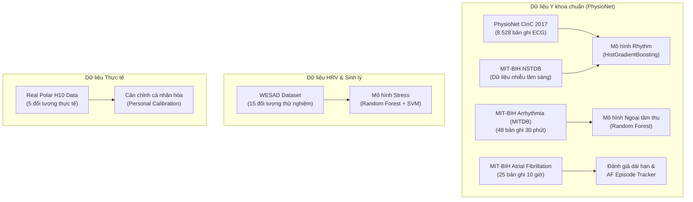

# Giới Thiệu Các Bộ Dữ Liệu Sử Dụng Trong Đồ Án (Datasets)

Tài liệu này tổng hợp chi tiết các bộ dữ liệu (datasets) y khoa quốc tế và dữ liệu tự thu thập được sử dụng để huấn luyện (training) và đánh giá (evaluation) các mô hình AI trong hệ thống **Elderly Care**. Bạn có thể dùng trực tiếp nội dung này để đưa vào các slide thuyết trình bảo vệ đồ án.

---

## 1. Tổng Quan Hệ Thống Dữ Liệu Sử Dụng

Để giải quyết đồng thời nhiều bài toán sàng lọc sức khỏe, đồ án đã tích hợp **5 bộ dữ liệu chuẩn quốc tế (PhysioNet/MIT-BIH/WESAD)** và **1 bộ dữ liệu tự thu thập thực tế** từ cảm biến Polar H10:

---

## 2. Chi Tiết Từng Bộ Dữ Liệu

### 2.1 Bộ Dữ Liệu Nhận Diện Nhịp Tim & Rung Nhĩ: PhysioNet CinC Challenge 2017
* **Mục đích sử dụng:** Huấn luyện mô hình phân loại nhịp tim chính (Rhythm Feature Model).
* **Thông số kỹ thuật:**
  * **Quy mô:** **8.528 bản ghi** ECG 1-lead (đơn kênh) ngắn từ 9 giây đến 60 giây (trung bình 30 giây).
  * **Tần số lấy mẫu:** Gốc 300 Hz $\rightarrow$ Được **resample về 130 Hz** để đồng bộ với tần số truyền thực tế của Polar H10.
  * **Cơ cấu nhãn (Labels):** 
    1. **Normal:** Nhịp xoang bình thường.
    2. **Possible AFib:** Nhịp nghi ngờ rung nhĩ.
    3. **Other rhythm:** Các loại loạn nhịp khác.
    4. **Noise:** Tín hiệu nhiễu không thể đọc.

### 2.2 Bộ Dữ Liệu Tăng Cường Nhiễu: MIT-BIH Noise Stress Test Database (NSTDB)
* **Mục đích sử dụng:** Tăng cường dữ liệu (Data Augmentation) để mô hình rhythm nhận diện chính xác trạng thái nhiễu, giảm thiểu báo động giả khi người cao tuổi di chuyển làm dây đeo bị lỏng.
* **Thông số kỹ thuật:**
  * Gồm các bản ghi chứa 3 loại nhiễu vật lý phổ biến:
    * **BW (Baseline Wander):** Nhiễu do hô hấp, lồng ngực di động.
    * **MA (Muscle Artifact):** Nhiễu do co cơ khi vận động.
    * **EM (Electrode Motion):** Nhiễu do điện cực tiếp xúc lỏng với da.
  * **Kết quả ứng dụng:** Việc trộn nhiễu từ NSTDB vào tập train giúp mô hình tăng tỷ lệ nhận diện nhiễu (Noise Recall) từ **40% lên 85.5%**, bảo vệ hệ thống khỏi các cảnh báo sai.

### 2.3 Bộ Dữ Liệu Huấn Luyện Ngoại Tâm Thu: MIT-BIH Arrhythmia Database (MITDB)
* **Mục đích sử dụng:** Huấn luyện mô hình phát hiện các nhịp ngoại tâm thu nhĩ (PAC) và ngoại tâm thu thất (PVC) trong mô hình Ectopy.
* **Thông số kỹ thuật:**
  * **Quy mô:** **48 bản ghi** ECG 2 kênh, thời lượng 30 phút mỗi bản ghi.
  * **Tần số lấy mẫu:** Gốc 360 Hz $\rightarrow$ resample về 130 Hz.
  * **Đặc điểm:** Chứa nhãn chú thích chi tiết cho từng nhịp đập đơn lẻ (beat-by-beat annotations) bởi các chuyên gia tim mạch. Được cắt thành các cửa sổ 30 giây để trích xuất các đặc trưng khoảng nghỉ bù (compensatory pause) và biến đổi hình thái QRS.

### 2.4 Bộ Dữ Liệu Đánh Giá Dài Hạn: MIT-BIH Atrial Fibrillation Database (AFDB)
* **Mục đích sử dụng:** Đánh giá hiệu năng kiểm thử dài hạn của mô hình phát hiện rung nhĩ và kiểm chứng thuật toán theo dõi phiên rung nhĩ (AF Episode Tracker).
* **Thông số kỹ thuật:**
  * **Quy mô:** **25 bản ghi** Holter ECG dài hạn, thời lượng **10 giờ** mỗi bản ghi.
  * **Tần số lấy mẫu:** 250 Hz.
  * **Ứng dụng:** Dùng làm Benchmark đánh giá sai số của chỉ số Gánh nặng rung nhĩ (AF Burden %) theo thời gian thực (đạt sai số trung bình cực thấp, chỉ 6.9%).

### 2.5 Bộ Dữ Liệu Phát Hiện Căng Thẳng: WESAD (Wearable Stress and Affect Detection)
* **Mục đích sử dụng:** Huấn luyện mô hình phát hiện stress tâm sinh lý dựa trên biến thiên nhịp tim (HRV).
* **Thông số kỹ thuật:**
  * **Quy mô:** Dữ liệu thu thập từ **15 đối tượng thử nghiệm** (S2 - S17).
  * **Tần số lấy mẫu:** ECG gốc 700 Hz.
  * **Kịch bản thu thập:** Các đối tượng được trải qua các pha trạng thái rõ ràng: *Baseline* (Bình thường), *Stress* (Kích thích căng thẳng qua bài thuyết trình toán học và tiếng ồn lớn), *Amusement* (Vui vẻ qua clip hài).
  * **Trích xuất:** Trích xuất các đặc trưng HRV trong cửa sổ trượt 300 giây (5 phút), dịch chuyển 60 giây.

### 2.6 Bộ Dữ Liệu Tự Thu Thập Thực Tế (Polar H10 Real Data)
* **Mục đích sử dụng:** Calibrate (cân chỉnh) mô hình phát hiện bất thường Isolation Forest theo từng cá nhân và kiểm thử hệ thống phần cứng thực tế.
* **Thông số kỹ thuật:**
  * **Quy mô:** Thu thập từ **5 đối tượng thực tế** (Chinh, Amine, Huy, Emna, Vinh).
  * **Kịch bản:** Mỗi người thực hiện đo ở 3 trạng thái hoạt động:
    1. **Rest (Nghỉ ngơi):** Nằm hoặc ngồi yên tĩnh (10 phút $\times$ 3 lần).
    2. **Walk (Đi bộ):** Đi bộ chậm trong phòng (5 phút $\times$ 3 lần).
    3. **Active (Vận động):** Vận động mạnh, leo cầu thang (3 phút $\times$ 2 lần).
  * Dữ liệu được lưu trữ có cấu trúc tại thư mục `data_raw/real_data/` gồm đầy đủ 3 trục gia tốc kế (ACC) và ECG đơn kênh 130 Hz.

---

## 3. Bảng Tổng Hợp Tham Chiếu Cho Slide Thuyết Trình

| Bộ dữ liệu (Dataset) | Số lượng bản ghi / Đối tượng | Tần số gốc | Vai trò trong Đồ án | Model áp dụng |
|---|---|---|---|---|
| **PhysioNet CinC 2017** | 8.528 bản ghi (30s) | 300 Hz | Huấn luyện phân loại nhịp tim | Rhythm Feature Model |
| **MIT-BIH NSTDB** | 3 loại nhiễu lâm sàng | - | Tăng cường dữ liệu, chống báo giả | Rhythm Feature Model |
| **MIT-BIH MITDB** | 48 bản ghi (30 phút) | 360 Hz | Huấn luyện phát hiện ngoại tâm thu | Ectopy (PVC/PAC) Model |
| **MIT-BIH AFDB** | 25 bản ghi (10 giờ) | 250 Hz | Đánh giá dài hạn & tính AF Burden | AF Episode Tracker |
| **WESAD** | 15 đối tượng thử nghiệm | 700 Hz | Huấn luyện phát hiện stress | Stress HRV Model |
| **Dữ liệu Polar H10 thực tế** | 5 đối tượng (Rest/Walk/Active) | 130 Hz / 25 Hz | Cân chỉnh cá nhân hóa & Test phần cứng | Personal Calibration |
