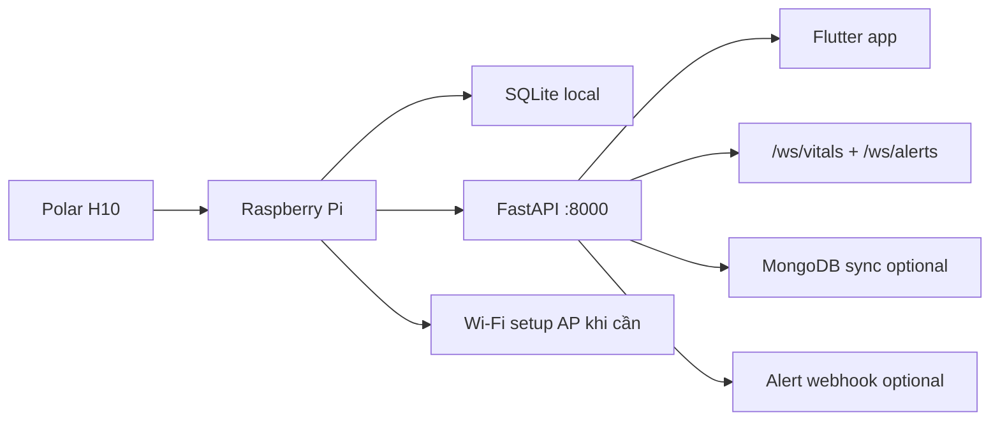

# Deploy ElderlyCareModel lên Raspberry Pi

Ngày cập nhật: 2026-06-08

Tài liệu này là hướng dẫn production hiện tại cho Raspberry Pi chạy backend Edge AI 24/7, tự kết nối Polar H10, lưu SQLite local, phát cảnh báo realtime cho app và đồng bộ cloud/MongoDB khi được cấu hình.

## 1. Mục tiêu production

Sau khi cài xong, Raspberry Pi cần đạt các điều kiện:

- Backend FastAPI chạy bằng `elderly-care.service` trên `0.0.0.0:8000`.
- Polar H10 tự bắt đầu thu sau khi Pi boot (`POLAR_AUTO_START=1`).
- Nếu mất BLE, collector tự reconnect.
- Nếu không có Internet, hệ thống vẫn lưu SQLite local.
- Nếu có Internet và `MONGODB_SYNC_ENABLED=1`, dữ liệu được đồng bộ MongoDB định kỳ.
- Nếu Pi không vào được Wi-Fi cũ, service provisioning phát AP `ElderlyCare-Setup-XXXX`.
- Flutter app truy cập qua `http://elderlycare.local:8000` hoặc IP của Pi.

## 2. Kiến trúc runtime



Không dùng `0.0.0.0` trong browser/app. `0.0.0.0` chỉ là địa chỉ bind server. Từ máy khác dùng:

```text
http://elderlycare.local:8000
http://<IP_RASPBERRY>:8000
```

## 3. Chuẩn bị

Phần cứng khuyến nghị:

- Raspberry Pi 4/5, ưu tiên OS 64-bit.
- Thẻ microSD/SSD đủ tốt, tối thiểu 32GB.
- Nguồn ổn định.
- Polar H10 và dây đeo đã làm ướt điện cực khi test.
- Wi-Fi hoặc LAN để cài lần đầu.

Phần mềm:

- Raspberry Pi OS Bookworm 64-bit.
- SSH bật trong Raspberry Pi Imager.
- Hostname khuyến nghị: `elderlycare`.
- Username hiện script/unit mặc định dùng: `elcaprj`.

Nếu dùng username khác, script production sẽ cố tự nhận user từ thư mục project. Với unit file thủ công, cần sửa `/home/elcaprj/elderly_care` thành path thật.

## 4. Flash Raspberry Pi OS

Trong Raspberry Pi Imager:

1. Chọn Raspberry Pi OS 64-bit.
2. Bật SSH.
3. Đặt hostname `elderlycare`.
4. Đặt username/password.
5. Có thể nhập Wi-Fi ban đầu nếu biết mạng.
6. Set locale `Asia/Ho_Chi_Minh`.

Boot Pi, đợi 1-3 phút rồi SSH:

```powershell
ssh elcaprj@elderlycare.local
```

Nếu `.local` không resolve, xem IP trên router hoặc dùng màn hình/VNC.

## 5. Lấy code lên Pi

Cách khuyến nghị trong giai đoạn dev:

```bash
cd /home/elcaprj
git clone https://github.com/ducchinhsero/ElderlyCareModel.git elderly_care
cd elderly_care
```

Nếu deploy bằng zip, giải nén vào:

```text
/home/elcaprj/elderly_care
```

Thư mục tối thiểu cần có:

```text
src/
models/
deploy/
scripts/
pipeline.py
requirements.txt
.env.example
```

## 6. Cài production một lệnh

Chạy từ root project trên Pi:

```bash
cd /home/elcaprj/elderly_care
bash scripts/install_pi_production.sh
```

Script sẽ:

- cài Python/system dependencies;
- bật Bluetooth, NetworkManager, Avahi/mDNS, Mosquitto;
- tạo/cập nhật `.venv`;
- cài `requirements.txt`;
- tạo/cập nhật `.env`;
- bật mặc định `POLAR_AUTO_START=1`;
- tạo `data/`, `logs/`;
- cài `elderly-care.service`;
- cài `elderly-care-wifi-provisioner.service`;
- restart services và smoke test `/health`.

Set Polar MAC ngay khi cài:

```bash
cd /home/elcaprj/elderly_care
POLAR_H10_MAC=24:AC:AC:13:EB:86 bash scripts/install_pi_production.sh
```

Cấu hình MongoDB sync ngay khi cài:

```bash
cd /home/elcaprj/elderly_care
POLAR_H10_MAC=24:AC:AC:13:EB:86 \
MONGODB_SYNC_ENABLED=1 \
MONGODB_URI='mongodb+srv://...' \
bash scripts/install_pi_production.sh
```

## 7. File `.env` quan trọng

File production nằm ở:

```text
/home/elcaprj/elderly_care/.env
```

Các giá trị cần kiểm tra:

```env
API_HOST=0.0.0.0
API_PORT=8000
ECG_DATA_DIR=./data

POLAR_H10_MAC=24:AC:AC:13:EB:86
POLAR_AUTO_START=1
POLAR_AUTO_START_CHUNK_SECONDS=10
POLAR_CONNECT_TIMEOUT_SECONDS=20
POLAR_RECONNECT_SECONDS=10

ANOMALY_ENABLED=1
ANOMALY_CALIBRATION_ENABLED=0

MQTT_ENABLED=1
MQTT_HOST=localhost
MQTT_PORT=1883

MONGODB_URI=
MONGODB_SYNC_ENABLED=0

WIFI_INTERFACE=wlan0
WIFI_AP_SSID_PREFIX=ElderlyCare-Setup
WIFI_SETUP_IP=10.42.0.1
```

Không commit `.env` thật.

## 8. Kiểm tra Polar H10

Polar H10 chỉ phát BLE khi đang được đeo và điện cực đủ ẩm.

Chuẩn bị:

- Đeo Polar H10 lên ngực.
- Làm ướt hai cực dây strap.
- Đóng app Polar Flow trên điện thoại nếu app đó đang kết nối.
- Đợi 5-10 giây.

Scan:

```bash
sudo timeout 15 bluetoothctl --timeout 10 scan on 2>&1 | grep -i polar
```

Kỳ vọng thấy:

```text
[NEW] Device 24:AC:AC:13:EB:86 Polar H10 ...
```

Nếu MAC khác, sửa `.env`:

```bash
nano /home/elcaprj/elderly_care/.env
sudo systemctl restart elderly-care
```

## 9. Kiểm tra service

```bash
sudo systemctl status elderly-care --no-pager
sudo systemctl status elderly-care-wifi-provisioner --no-pager
```

Xem health:

```bash
curl -s http://127.0.0.1:8000/health | python3 -m json.tool
```

Các field quan trọng:

- `status = "ok"`
- `sklearn_version_ok = true`
- `rhythm_model_loaded = true`
- `stress_model_loaded = true`
- `ectopy_model_loaded = true`
- `anomaly_model_loaded = true`
- `polar.running = true` sau khi auto-start bắt đầu
- `polar.auto_start = true`
- `network_provisioning.mode = "client"` hoặc `"ap"`

Nếu `polar.running=false`, xem:

```bash
tail -80 /home/elcaprj/elderly_care/logs/uvicorn.log
tail -80 /home/elcaprj/elderly_care/logs/uvicorn.err.log
```

## 10. Test thu dữ liệu

Đợi ít nhất 10-30 giây để có chunk đầu tiên:

```bash
curl -s http://127.0.0.1:8000/latest-result | python3 -m json.tool
```

Kỳ vọng có:

- `latest_result.heart_rate_bpm`
- `latest_result.rhythm`
- `latest_result.signal_quality`
- `latest_result.alert_level`
- `polar.last_packet_at`
- `polar.last_prediction_at`

Nếu cần bật Polar thủ công:

```bash
curl -X POST http://127.0.0.1:8000/polar/start
```

Việc phải bấm `/dashboard` để start Polar là dấu hiệu `.env` chưa có `POLAR_AUTO_START=1` hoặc service chưa restart sau khi sửa `.env`.

## 11. Wi-Fi provisioning khi đến nơi mới

Nếu Pi không vào được Wi-Fi đã lưu, service provisioning sẽ phát:

```text
SSID: ElderlyCare-Setup-XXXX
Portal: http://10.42.0.1
```

Luồng sử dụng:

1. Kết nối điện thoại/laptop vào Wi-Fi `ElderlyCare-Setup-XXXX`.
2. Mở app Flutter màn "Thiết lập Wi-Fi Raspberry" hoặc mở browser `http://10.42.0.1`.
3. Quét/chọn Wi-Fi nhà, nhập password.
4. Gửi cấu hình.
5. Nếu AP biến mất, đó thường là dấu hiệu Pi đang chuyển sang Wi-Fi nhà.
6. Kết nối thiết bị trở lại Wi-Fi nhà.
7. Truy cập backend bằng `http://elderlycare.local:8000` hoặc IP mới của Pi.

Kiểm tra trạng thái trên Pi:

```bash
cd /home/elcaprj/elderly_care
sudo .venv/bin/python -m src.network.provisioning --status
journalctl -u elderly-care-wifi-provisioner -n 100 --no-pager
```

Mật khẩu AP:

- Nếu đặt trong `.env`: `WIFI_AP_PASSWORD=...`
- Nếu để trống, installer/service sinh và lưu trong state/data theo cấu hình `WIFI_PROVISIONING_STATE_DIR`.

## 12. App Flutter kết nối Pi

Trong app:

- Người đeo nhập `elderlycare.local` hoặc IP Pi ở Settings.
- Nếu auth bật, nhập API key tương ứng.
- Không nhập `0.0.0.0`.
- Dùng `/health` để kiểm tra kết nối.

Caregiver từ xa cần cloud/base URL có thể truy cập được từ ngoài LAN. Nếu chỉ dùng Pi trong LAN, caregiver phải cùng mạng hoặc qua VPN/tunnel.

## 13. Endpoint vận hành nhanh

```bash
# Health/model/Polar/network
curl -s http://127.0.0.1:8000/health | python3 -m json.tool

# Prediction mới nhất
curl -s http://127.0.0.1:8000/latest-result | python3 -m json.tool

# Timeline events
curl -s "http://127.0.0.1:8000/events?limit=20" | python3 -m json.tool

# Urgent alerts high/critical
curl -s "http://127.0.0.1:8000/alerts/realtime?limit=20" | python3 -m json.tool

# Storage
curl -s http://127.0.0.1:8000/storage/status | python3 -m json.tool

# Manual sync
curl -X POST http://127.0.0.1:8000/storage/sync-mongodb \
  -H "Content-Type: application/json" \
  -d '{"patient_id":"polar_h10","days":1,"limit":5000}'
```

## 14. Log và debug

```bash
# Backend logs
tail -f /home/elcaprj/elderly_care/logs/uvicorn.log
tail -f /home/elcaprj/elderly_care/logs/uvicorn.err.log
sudo journalctl -u elderly-care -f

# Wi-Fi provisioning
sudo journalctl -u elderly-care-wifi-provisioner -f

# Bluetooth
hciconfig hci0
sudo systemctl restart bluetooth
sudo timeout 15 bluetoothctl --timeout 10 scan on 2>&1 | grep -i polar

# Port
sudo ss -tlnp | grep 8000

# IP Pi
hostname -I
ip addr show wlan0
```

## 15. Troubleshooting ngắn

### Không vào được `elderlycare.local`

- Kiểm tra cùng mạng Wi-Fi/LAN.
- Lấy IP bằng `hostname -I` trên Pi.
- Dùng `http://<IP>:8000/health`.
- Nếu SSH báo host key changed, xóa known_hosts cũ:

```powershell
ssh-keygen -R elderlycare.local
ssh-keygen -R <IP_CU>
```

### Polar không tự chạy sau boot

```bash
grep '^POLAR_AUTO_START' /home/elcaprj/elderly_care/.env
sudo systemctl restart elderly-care
curl -s http://127.0.0.1:8000/health | python3 -m json.tool | grep -A30 '"polar"'
```

Phải là `POLAR_AUTO_START=1`. Nếu vẫn lỗi, kiểm tra `polar.last_error`, MAC, dây đeo, pin và Bluetooth.

### App báo mất kết nối

- Không dùng `0.0.0.0`.
- Nếu app chạy trên Windows còn backend trên Pi, không dùng `127.0.0.1`.
- Dùng `elderlycare.local` hoặc IP Pi.
- Kiểm tra firewall/router và `sudo ss -tlnp | grep 8000`.

### MQTT lỗi trên Flutter Web

Flutter Web không dùng raw TCP MQTT ổn định. Dùng REST/WebSocket cho Web, hoặc cấu hình MQTT-over-WebSocket riêng nếu thật sự cần.

### MongoDB không có dữ liệu realtime

MongoDB là kênh sync/archive. Cảnh báo realtime đi qua `/ws/alerts`, `/alerts/realtime`, webhook hoặc MQTT LAN. Kiểm tra `/storage/sync-scheduler/status` nếu cần xác nhận sync.

## 16. Checklist hoàn tất

- [ ] SSH được vào Pi.
- [ ] `bash scripts/install_pi_production.sh` chạy xong.
- [ ] `elderly-care.service` active.
- [ ] `elderly-care-wifi-provisioner.service` active.
- [ ] `/health.status = ok`.
- [ ] `sklearn_version_ok = true`.
- [ ] Các model chính loaded.
- [ ] `POLAR_AUTO_START=1`.
- [ ] Polar H10 được scan thấy khi đang đeo.
- [ ] `/latest-result` có dữ liệu sau 10-30 giây.
- [ ] App Flutter kết nối bằng `elderlycare.local` hoặc IP Pi.
- [ ] Khi Wi-Fi cũ không có, AP `ElderlyCare-Setup-XXXX` xuất hiện.

## 17. Tài liệu liên quan

- `README.md`: tổng quan backend.
- `docs/wifi-provisioning-production.md`: chi tiết Wi-Fi captive portal.
- `docs/model-storage-alert-system.md`: luồng model/storage/cảnh báo.
- `docs/model-training-results-report.md`: kết quả train/evaluate model.
- `MODEL_NOTES.md`: contract backend cho app.
