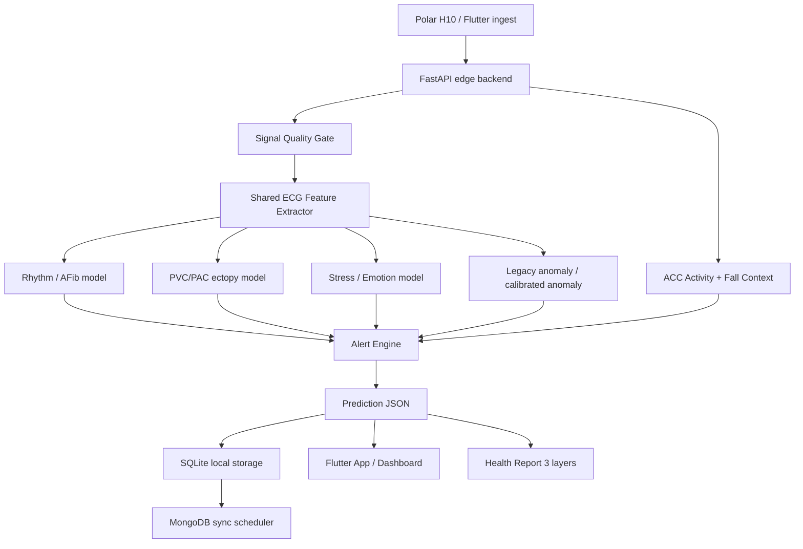

# Kien Truc Tich Hop Stress Detection Va Dong Bo He Thong

Ngay tao: 2026-05-24  
Pham vi: backend model pipeline, stress/emotion model, API output, storage, Flutter app, Raspberry/edge deployment.

## 1. Muc tieu

Tai lieu nay la hop dong ky thuat de tich hop model stress detection do teammate phat trien vao he thong backend hien tai ma khong lam hong cac module da on dinh:

- realtime ECG/ACC pipeline;
- rhythm model va AFib/PVC/PAC screening;
- signal quality;
- fall/activity context;
- health report 3 tang;
- SQLite chunk storage;
- MongoDB sync;
- Flutter app/caregiver UI.

Model stress khong duoc tich hop theo kieu chen truc tiep tuy y vao `pipeline.py`. Can thong qua interface ro rang, artifact ro rang, feature schema ro rang va test gate bat buoc.

## 2. Ten goi logic trong he thong

Trong code hien tai, output dang duoc dat ten la `emotion` de ho tro 3 lop:

| Class ID | Label | Y nghia |
|---:|---|---|
| `1` | `neutral` | trang thai nen/binh thuong |
| `2` | `stress` | nghi ngo stress sinh ly |
| `4` | `relaxed` | thu gian/thien/hoi phuc |

Trong UI va bao cao co the hien thi la "Stress / Recovery status", nhung trong API nen giu key `emotion` de tranh pha vo tuong thich voi app hien co.

Khuyen nghi:

- API internal key: `emotion`
- Wording UI: `Trang thai stress/thu gian`
- Model artifact folder: `models/emotion/`
- Neu sau nay chi train binary stress/non-stress, van nen map vao output `emotion` voi `neutral`, `stress`, `relaxed/unknown` de giu contract.

## 3. Kien truc tong the



Nguyen tac chinh:

1. ECG raw chi di qua mot feature extractor dung chung.
2. Moi model phai co artifact + schema + metrics rieng.
3. API output phai on dinh, khong thay key tuy tien.
4. Stress model chi tao screening/risk signal, khong chan doan benh.
5. Neu signal quality kem, stress output phai la `unknown`, khong ep predict.

## 4. Ranh gioi module

### 4.1 Backend core giu on dinh

Khong nen sua tuy tien:

```text
src/api/pipeline.py
src/storage/ecg_storage.py
src/storage/background_sync.py
src/storage/mongodb_sync.py
src/assessment/
src/inference/alert_engine.py
```

Neu can sua, phai co test regression vi cac file nay anh huong realtime API, dashboard, storage va app.

### 4.2 Module stress/emotion duoc phep thay doi

Teammate co the cap nhat:

```text
src/training/train_emotion_wesad.py
src/features/ecg_features.py
models/emotion/
tests/test_ecg_features.py
tests/test_daily_health_api.py
```

Neu feature schema thay doi, bat buoc cap nhat ca training va inference.

### 4.3 Huong refactor khuyen nghi

Hien tai `pipeline.py` dang load va predict emotion truc tiep. Khi merge lon, nen tach thanh adapter rieng:

```text
src/inference/emotion_inference.py
```

Adapter nen co interface:

```python
class EmotionPredictor:
    def __init__(self, model_path, schema_path, label_map):
        ...

    def predict(self, feature_rows):
        return {
            "label": "neutral|stress|relaxed|unknown",
            "class_id": 1 | 2 | 4 | None,
            "confidence": 0.0,
            "probabilities": {
                "neutral": 0.0,
                "stress": 0.0,
                "relaxed": 0.0
            },
            "model_version": "...",
            "reason": "optional"
        }
```

Sau khi adapter on dinh, `pipeline.py` chi goi `emotion_predictor.predict(...)`.

## 5. Artifact contract

Stress/emotion model phai export day du cac file sau:

```text
models/emotion/emotion_model.pkl
models/emotion/emotion_feature_schema.json
models/emotion/emotion_metrics.json
models/emotion/emotion_label_map.json        # optional, khuyen nghi them
models/emotion/emotion_model_card.md         # optional, khuyen nghi them
```

Khong commit file `.pkl` len GitHub neu qua lon hoac thay doi thuong xuyen. Repo hien dang ignore:

```text
models/**/*.pkl
models/**/*.pt
models/**/*.keras
```

Can commit cac file nho:

- schema JSON;
- metrics JSON;
- label map;
- model card;
- train script.

Model artifact `.pkl` nen duoc chuyen rieng qua Google Drive, release asset, DVC, Hugging Face, hoac storage noi bo.

## 6. Feature schema contract

Feature emotion hien tai di tu `src/features/ecg_features.py`.

Bat buoc:

- training va inference dung cung `EMOTION_FEATURE_COLUMNS`;
- `emotion_feature_schema.json` phai trung 100% thu tu cot;
- moi phep tinh HRV phai dung `sample_rate_hz` cua nguon du lieu;
- WESAD train dung `700 Hz`;
- Polar realtime dung `130 Hz` hoac sample rate client gui;
- khong hard-code mot sample rate chung cho tat ca nguon.

Neu teammate them feature moi, phai lam 3 viec cung luc:

1. Cap nhat extractor trong `src/features/ecg_features.py`.
2. Train lai model va export schema moi.
3. Cap nhat test schema trong `tests/test_ecg_features.py`.

## 7. Input/Output contract cua stress model

### 7.1 Input

Stress model khong nhan ECG raw truc tiep trong v1. Input la feature rows da qua:

- ECG bandpass filter;
- R-peak detection;
- RR intervals;
- HRV/time-domain/frequency-domain features;
- signal quality gate.

Dang du lieu:

```python
feature_rows: list[dict]
```

Moi row tuong ung mot prediction window.

### 7.2 Output

Output bat buoc phai theo shape:

```json
{
  "label": "neutral",
  "class_id": 1,
  "confidence": 0.72,
  "probabilities": {
    "neutral": 0.72,
    "stress": 0.18,
    "relaxed": 0.10
  }
}
```

Neu khong du tin cay:

```json
{
  "label": "unknown",
  "class_id": null,
  "confidence": 0.0,
  "probabilities": {
    "neutral": 0.0,
    "stress": 0.0,
    "relaxed": 0.0
  },
  "reason": "Poor signal quality or insufficient reliable windows."
}
```

## 8. Quyen uu tien trong alert engine

Stress khong duoc la alert chinh neu rhythm co nguy co cao hon.

Thu tu uu tien de alert:

1. `critical`: fall candidate nghiem trong, rhythm nguy co cao, AF episode dai, HR bat thuong nang.
2. `high`: AFib suspicion lap lai, PVC/PAC burden cao, fall candidate.
3. `medium`: stress lap lai trong tin hieu tot, tachy/brady nhe, poor signal keo dai.
4. `low/normal`: khong co mau bat thuong dang ke.
5. `unknown`: tin hieu kem hoac thieu du lieu.

Neu dang `ACTIVE` hoac `WALK`, stress confidence thap khong nen day alert len cao vi HRV bi anh huong boi van dong.

## 9. API contract sau khi merge

`POST /ingest-ecg` va `GET /latest-result` tiep tuc tra:

```json
{
  "patient_id": "polar_h10",
  "timestamp": "...",
  "heart_rate_bpm": 78.4,
  "emotion": {
    "label": "stress",
    "class_id": 2,
    "confidence": 0.81,
    "probabilities": {
      "neutral": 0.12,
      "stress": 0.81,
      "relaxed": 0.07
    }
  },
  "rhythm": {
    "label": "normal",
    "confidence": 0.8
  },
  "signal_quality": {
    "label": "good",
    "score": 0.9
  },
  "alert_level": "medium",
  "message": "Stress pattern detected. No significant rhythm abnormality detected."
}
```

`GET /health-report` phai tong hop stress theo 3 tang:

| Layer | Cach dung stress |
|---|---|
| realtime | trang thai stress cua window moi nhat |
| daily | ti le stress trong 24 gio, chi tinh window tin hieu tot |
| long_term | so voi personal baseline 7 ngay |

## 10. Storage contract

Bang `predictions` luu `emotion_json`. Khi merge stress model moi:

- khong doi ten cot;
- khong doi key `emotion`;
- co the them field moi ben trong JSON neu backward-compatible.

Field co the them:

```json
{
  "model_version": "emotion_rf_wesad_v2",
  "feature_schema_version": "2026-05-24",
  "source": "wesad_ecg_hrv",
  "calibration": {
    "personal_baseline_adjusted": false
  }
}
```

## 11. Personal baseline va stress

Baseline 7 ngay co huong dan REST/WALK/ACTIVE khong nen dung de train lai WESAD model ngay lap tuc. Nen dung truoc cho calibration threshold:

- HR khi REST cua ca nhan;
- HRV REST cua ca nhan;
- stress ratio binh thuong cua ca nhan;
- stress confidence trung binh khi tin hieu tot;
- activity-aware stress suppression.

Sau khi co du du lieu nhieu nguoi va co label that, moi xem xet fine-tune/train lai model ca nhan.

## 12. Ke hoach merge voi teammate

### Phase S1: Dong bang interface

- Giu output key `emotion`.
- Giu 3 label `neutral`, `stress`, `relaxed`.
- Giu artifact path `models/emotion/`.
- Giu shared feature extractor.

### Phase S2: Nhan artifact tu teammate

Teammate can ban giao:

```text
emotion_model.pkl
emotion_feature_schema.json
emotion_metrics.json
train script
short model report
```

Can kiem tra:

- schema co trung extractor khong;
- model load duoc bang `joblib.load`;
- `predict_proba` co tra dung 3 class khong;
- class id co dung `1,2,4` khong;
- metrics co GroupKFold theo subject khong.

### Phase S3: Tich hop adapter

- Tao `src/inference/emotion_inference.py`.
- Pipeline load qua adapter.
- Them field `model_version`.
- Them reason khi output `unknown`.

### Phase S4: Regression

Chay:

```powershell
python -m py_compile src\api\pipeline.py src\features\ecg_features.py src\training\train_emotion_wesad.py
python -m unittest discover -s tests -q
```

### Phase S5: Soak test

Chay API:

```powershell
uvicorn pipeline:app --host 127.0.0.1 --port 8000 --app-dir .
```

Chay soak test:

```powershell
python -m src.services.soak_test --base-url http://127.0.0.1:8000 --duration-minutes 30 --check-storage
```

### Phase S6: App validation

Flutter app can hien thi:

- hien tai: `neutral/stress/relaxed/unknown`;
- confidence;
- daily stress ratio;
- so sanh voi baseline ca nhan;
- wording an toan: "co dau hieu stress sinh ly", khong ghi "ban dang bi stress benh ly".

## 13. Acceptance checklist truoc khi merge

Bat buoc pass:

- [ ] `.env` khong bi commit.
- [ ] `.pkl` khong bi commit neu repo khong dung Git LFS/release asset.
- [ ] `emotion_model.pkl` load duoc local.
- [ ] `emotion_feature_schema.json` trung `EMOTION_FEATURE_COLUMNS`.
- [ ] Output chi thuoc `neutral`, `stress`, `relaxed`, `unknown`.
- [ ] Poor signal tra `unknown`.
- [ ] `python -m unittest discover -s tests -q` pass.
- [ ] `/health` tra `emotion_model_loaded: true`.
- [ ] `/ingest-ecg` tra JSON dung shape.
- [ ] `/health-report` khong crash khi emotion la `unknown`.
- [ ] Dashboard va Flutter app khong crash khi thieu probabilities.

## 14. Rủi ro ky thuat can tranh

| Rui ro | Cach tranh |
|---|---|
| Training va inference lech feature | Bat buoc schema JSON va test schema |
| Sai sample rate | Moi extractor nhan `sample_rate_hz`, khong hard-code |
| Model WESAD khong hop Polar | Dung output screening, them personal baseline calibration |
| Stress false alert khi dang van dong | Activity-aware suppression |
| Poor signal van ep predict | Signal quality gate tra `unknown` |
| Merge conflict trong `pipeline.py` | Tach adapter `src/inference/emotion_inference.py` |
| Commit secret/model/data ca nhan | `.gitignore`, `.env.example`, review `git diff --cached` |

## 15. Ket luan kien truc

Stress detection nen duoc xem la mot module con trong Edge AI pipeline, khong phai module dieu khien toan bo canh bao. Model stress cung cap mot tin hieu sinh ly bo sung cho health report va alert engine, trong khi rhythm/AFib/PVC/PAC/fall/signal quality van la cac nguon canh bao uu tien cao hon.

Kien truc merge tot nhat:

```text
Shared feature extractor
    -> EmotionPredictor adapter
    -> stable emotion JSON
    -> alert engine + health report + storage + app
```

Lam theo contract nay se giup teammate co the nang cap model stress doc lap, con backend/app van van hanh on dinh.
