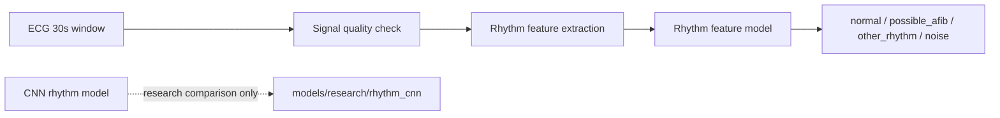
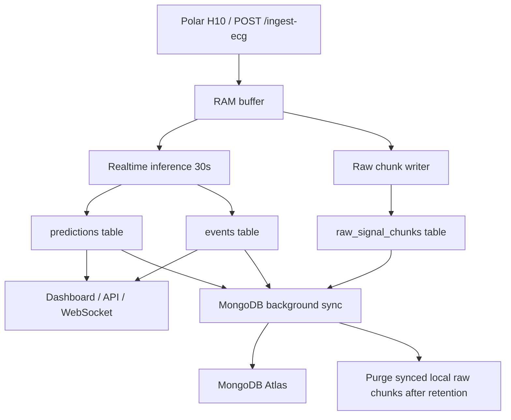
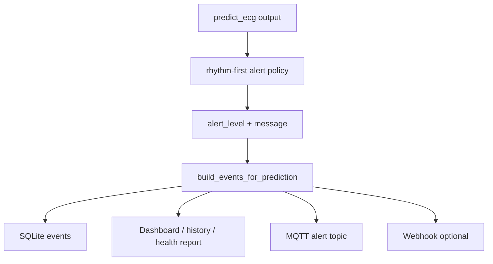

# Model, Storage va Alert System

Ngay cap nhat: 2026-05-28

Tai lieu nay tom tat ba phan can nam khi van hanh va thuyet trinh he thong:

- Lua chon model rhythm production.
- Luong luu tru local/cloud.
- Luong phat canh bao realtime.

He thong chi dua ra ket qua theo doi, risk va suspicion. Khong ket luan chan doan y khoa chac chan.

---

## 1. Model production va model research

### 1.1. Lua chon hien tai

Model rhythm production la **Rhythm feature model** trong `src/inference/rhythm_inference.py`.

CNN rhythm model van duoc giu lai de nghien cuu va thuyet trinh, nhung khong con nam trong runtime cua `src.api.pipeline`.



### 1.2. So sanh Feature model va CNN model

| Metric | Rhythm feature model | CNN rhythm model | Ket luan |
|---|---:|---:|---|
| Accuracy | 74.07% | 71.66% | Feature tot hon |
| Macro F1 | 71.44% | 55.15% | Feature tot hon ro |
| AFib recall | 66.05% | 38.65% | Feature it bo sot AFib hon |
| Noise recall | 85.54% | 48.00% | Feature nhan dien tin hieu nhieu tot hon |

Ly do chon feature model:

- AFib recall cao hon, phu hop muc tieu canh bao rung nhi nghi ngo.
- Noise recall cao hon, giam nguy co canh bao sai khi Polar H10 tiep xuc kem hoac nguoi dung van dong.
- Macro F1 cao hon, can bang cac lop tot hon thay vi chi tot lop `normal`.
- Nhe hon, khong can Torch, phu hop Raspberry Pi hon.
- De giai thich trong bao cao vi dua tren RR/HRV/morphology/signal quality.

### 1.3. Cach ly CNN

Production:

- `src.api.pipeline` chi import va chay `RhythmFeaturePredictor`.
- `/health` khong con dung `rhythm_cnn_model_loaded` lam trang thai production.
- `requirements.txt` khong con `torch`.

Research:

- CNN code van nam o `src/training/train_rhythm_cnn.py`.
- CNN inference helper van nam o `src/inference/rhythm_cnn_inference.py`.
- CNN artifact nam o `models/research/rhythm_cnn/`.
- Neu can chay lai CNN:

```bash
pip install -r requirements-research.txt
python -m src.training.train_rhythm_cnn --dataset-dir data_processed/rhythm --model-dir models/research/rhythm_cnn --metrics-dir models/metrics
```

Bao cao chi tiet: `docs/so-sanh-rhythm-cnn-feature-model.md`.

---

## 2. Luong luu tru

### 2.1. Luong du lieu realtime



### 2.2. Nen tang luu tru duoc dung

**SQLite local**

- Nam tren Raspberry Pi / edge server.
- La source local khi mat mang.
- Dung WAL mode de doc/ghi dong thoi on dinh hon.
- Luu prediction, events, session, raw ECG/ACC chunks, assessment snapshots.

**Raw signal chunks**

- ECG/ACC khong luu tung sample thanh tung row.
- Moi chunk mac dinh 5 giay.
- Payload luu dang BLOB nen zlib:
  - ECG: `int32_le_zlib`
  - ACC: `float32x4_le_zlib`
- Co checksum SHA-256 de kiem tra toan ven.

**MongoDB Atlas**

- Luu dai han tren cloud.
- Phu hop voi document JSON cua prediction, event, report, personal baseline.
- Dung de phuc vu app/cloud dashboard, backup va phan tich lich su.

### 2.3. Cac bang SQLite chinh

| Bang | Vai tro |
|---|---|
| `predictions` | Moi lan inference thanh cong/unknown deu tao ket qua model |
| `events` | Timeline canh bao: AF suspicion, ectopy, HR event, fall, poor signal |
| `raw_signal_chunks` | ECG/ACC raw dang BLOB nen, link voi prediction/session |
| `collection_sessions` | Phien thu du lieu: realtime, guided baseline, calibration |
| `collection_segments` | REST/WALK/ACTIVE hoac segment thu du lieu rieng |
| `assessment_snapshots` | Snapshot bao cao 24h/7 ngay da tinh |

### 2.4. Dong bo va purge

Background sync chay theo chu ky:

1. Doc du lieu chua sync trong SQLite.
2. Batch upsert len MongoDB.
3. Neu MongoDB ghi thanh cong, danh dau raw chunks `is_synced = 1`.
4. Purge raw chunks da sync sau retention mac dinh, nhung khong xoa chunk chua sync.

Endpoint/kiem tra van hanh:

- `GET /storage/status`
- `GET /storage/sync-scheduler/status`
- `POST /storage/sync-mongodb`
- `POST /storage/purge-synced`
- `logs/background_sync.log`
- `logs/background_sync_runs.jsonl`

Can theo doi:

- So raw chunks chua sync.
- Kich thuoc SQLite/WAL.
- Trang thai MongoDB configured/connected.
- Loi sync lap lai trong log.

---

## 3. Luong canh bao

### 3.1. Tu prediction sang event



### 3.2. Rule va uu tien alert

He thong dung rule engine, khong dung model rieng cho alert.

Thu tu uu tien:

1. Rhythm alert duoc uu tien truoc: `possible_afib`, rhythm probability, AF episode.
2. Risk trend co the nang muc neu lich su bat thuong lap lai.
3. Legacy anomaly chi la phu tro, khong duoc uu tien hon rhythm neu rhythm da ro.
4. Fall candidate tu ACC co the nang len `high` hoac `critical`.
5. HR context co the nang len `medium/high/critical` tuy tachycardia/bradycardia va activity.
6. Stress chi nang toi da `medium` va bi suppress khi activity la `WALK` hoac `ACTIVE`.
7. Signal quality kem tao event theo doi, khong ep du doan benh.

### 3.3. Event types

| Event type | Nguon | Muc canh bao |
|---|---|---|
| `af_suspicion` | rhythm + rhythm_alert | medium/high/critical |
| `ectopy_suspicion` | PVC/PAC model | medium |
| `tachycardia` | HR rule + activity | medium |
| `bradycardia` | HR rule | medium |
| `hr_context` | ACC/activity + HR context | medium/high |
| `fall_candidate` | ACC fall detection | high/critical |
| `poor_signal` | signal quality | unknown, dung de giai thich vi sao skip |
| `stress_suspicion` | stress model + signal/activity gate | medium |

### 3.4. Kenh gui canh bao

**Dashboard va WebSocket**

- Dashboard local doc `/latest-result`, `/events`, `/health-report`.
- WebSocket `/ws/vitals` dung cho stream realtime.

**MQTT**

- `{prefix}/{patient_id}/vitals/live`
  - QoS 0
  - retain false
  - dung cho du lieu live, mat goi nho khong nghiem trong.
- `{prefix}/{patient_id}/alert`
  - QoS 2
  - retain true
  - chi gui khi `alert_level >= MQTT_ALERT_MIN_LEVEL`, mac dinh medium.
  - app moi reconnect van nhan duoc canh bao moi nhat.
- `{prefix}/service/status`
  - QoS 1
  - retain true
  - co Last Will de bao Pi offline neu mat ket noi dot ngot.

**Webhook**

- Neu cau hinh `ALERT_WEBHOOK_URL`, backend POST alert payload len server/app/cloud.
- Dung cho tich hop cloud sau nay, khong bat buoc trong demo local.

### 3.5. Cach kiem tra alert dang chay dung

- Goi `/health`, kiem tra:
  - `mqtt_enabled`
  - `mqtt_connected`
  - `alert_webhook_configured`
  - `polar.running`
- Goi `/events?patient_id=polar_h10&days=1`.
- Kiem tra MQTT broker co topic alert retained.
- Kiem tra dashboard co cap nhat `alert_level`, event timeline va health report.

### 3.6. Bao mat API

Khi chi chay trong LAN/VPN, co the giu `API_AUTH_ENABLED=0` de demo nhanh. Truoc khi mo API ra ngoai LAN, bat API key:

```env
API_AUTH_ENABLED=1
API_KEY=<secret>
API_PUBLIC_PATHS=/health,/dashboard
ALLOWED_ORIGINS=https://your-app-domain.example
```

Client gui:

```http
X-API-Key: <secret>
```

Khong expose truc tiep cac endpoint dieu khien thiet bi va storage neu chua co auth: `/polar/*`, `/storage/*`, `/events/rebuild`, `/personal-baseline/*`, `/guided-baseline/*`.

---

## 4. Ket luan thuyet trinh

He thong da tach ro ba tang:

- **Model layer**: feature rhythm model la production, CNN la research comparison.
- **Storage layer**: SQLite local chunk buffer dam bao khong mat du lieu, MongoDB Atlas dung cho cloud/long-term.
- **Alert layer**: rule-based, rhythm-first, phat realtime qua dashboard/WebSocket/MQTT/webhook.

Lua chon nay phu hop muc tieu chay on dinh tren Raspberry Pi, giam dependency nang, van giu du lieu day du de calibration va mo rong model benh ly dai han.
