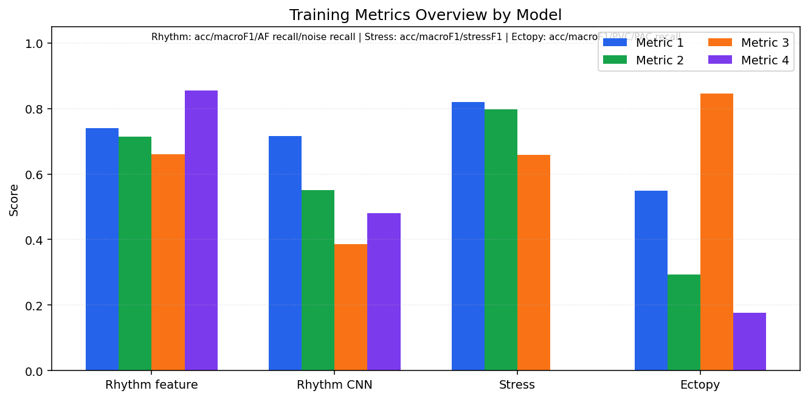
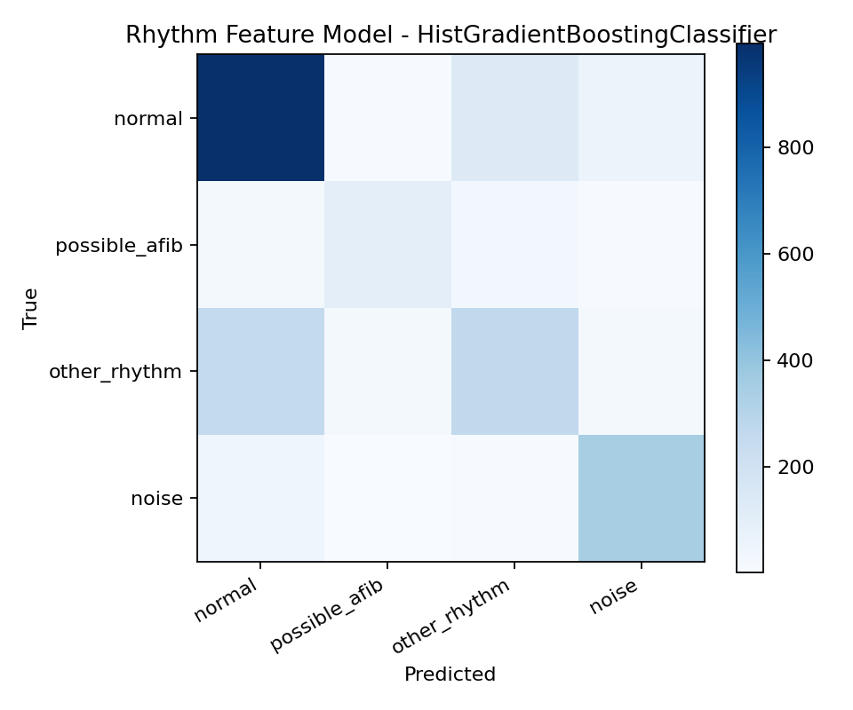
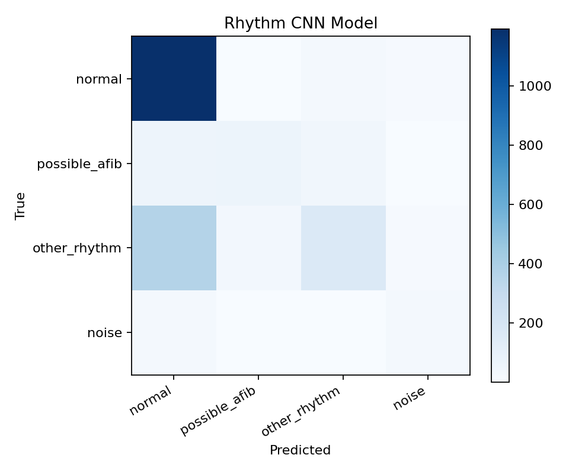
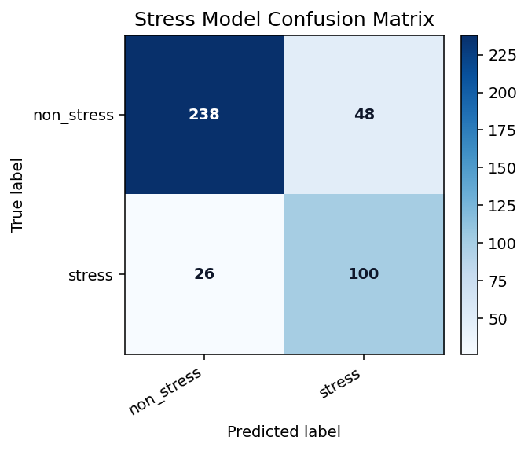
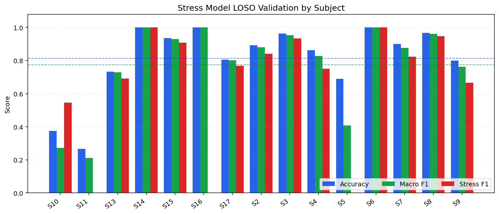
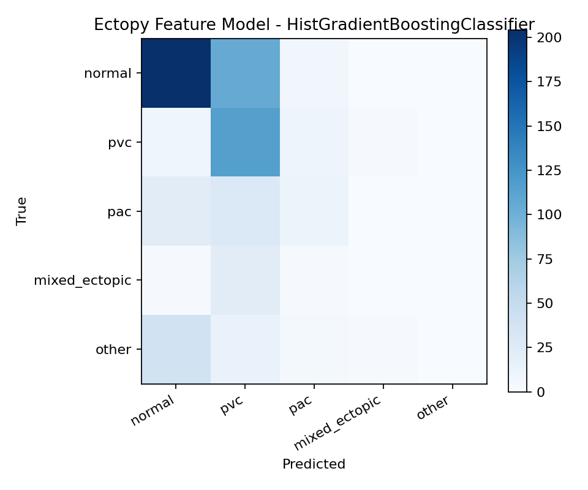
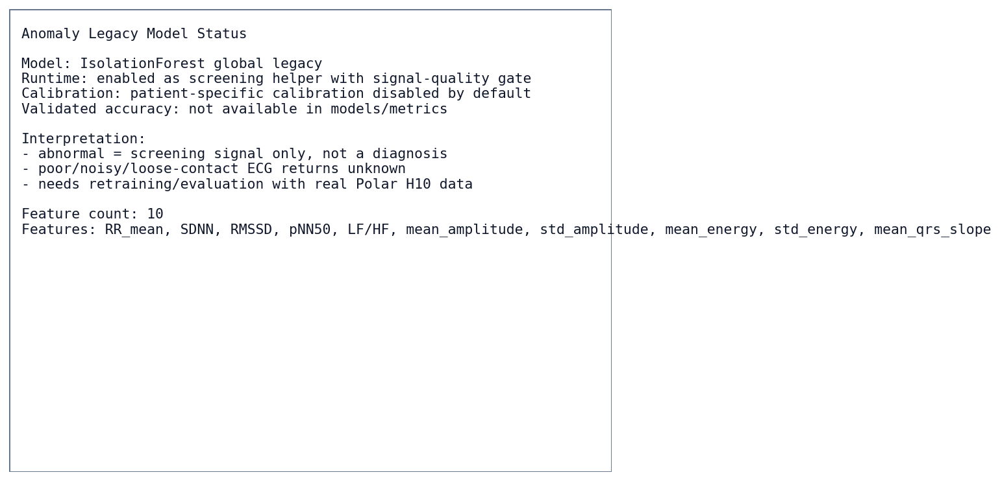

# Báo cáo kết quả train các model

Ngày cập nhật: 2026-06-08

Tài liệu này tổng hợp kết quả train/evaluate của các model đang có trong dự án. Mục tiêu là dùng cho báo cáo, thuyết trình và kiểm tra nhanh trước khi deploy Raspberry Pi.

Nguồn số liệu chính:

- `models/metrics/rhythm_feature_metrics.json`
- `models/metrics/rhythm_cnn_metrics.json`
- `models/metrics/stress_metrics.json`
- `models/metrics/ectopy_feature_metrics.json`
- `models/anomaly_legacy/*`

> Lưu ý: các kết quả dưới đây là kết quả nghiên cứu/sàng lọc, không phải validation lâm sàng. Hệ thống không được trình bày như thiết bị chẩn đoán y khoa độc lập.

## 1. Tóm tắt lựa chọn model

| Model | Vai trò hiện tại | Trạng thái runtime | Kết luận |
|---|---|---|---|
| Rhythm feature model | Phân loại nhịp ECG, AFib-like pattern, noise | Production chính | Chọn làm model realtime chính |
| Rhythm CNN 1D | So sánh deep learning trên raw ECG | Research-only | Không dùng runtime vì kém feature model ở macro F1, AFib recall và noise recall |
| Stress model | Sàng lọc stress sinh lý từ RR/HRV | Production screening phụ | Dùng được như tín hiệu phụ, cần đủ rolling RR khoảng 300 giây |
| PVC/PAC ectopy model | Sàng lọc ngoại tâm thu PVC/PAC-like | Production screening phụ | PVC recall tốt, PAC/mixed ectopic còn yếu |
| Anomaly legacy | Sàng lọc bất thường ECG tổng quát | Screening phụ | Đang bật global model, chưa có metrics accuracy hợp lệ |

Hình tổng quan so sánh một số metric chính:



## 2. Rhythm feature model

Đây là model production chính cho realtime rhythm/AFib pipeline.

| Thuộc tính | Giá trị |
|---|---|
| Model | `HistGradientBoostingClassifier` |
| Artifact | `models/rhythm/rhythm_feature_model.pkl` |
| Dataset | `data_processed/rhythm_nstdb_augmented` |
| Sample rate | 130 Hz |
| Window | 30 giây, 3900 mẫu/window |
| Dataset shape | 11.751 windows x 3900 samples |
| Feature shape | 11.751 windows x 41 features |
| Split | Group shuffle split theo record, test size 20%, record overlap 0 |
| Classes | `normal`, `possible_afib`, `other_rhythm`, `noise` |

Metric chính:

| Chỉ số | Giá trị |
|---|---:|
| Accuracy | 74,07% |
| Macro F1 | 71,44% |
| AFib recall | 66,05% |
| Noise recall | 85,54% |
| False AFib from noise rate | 0,50% |

Theo class quan trọng:

| Class | Precision | Recall | F1 |
|---|---:|---:|---:|
| `normal` | 76,07% | 84,46% | 80,05% |
| `possible_afib` | 75,35% | 66,05% | 70,39% |
| `noise` | 79,03% | 85,54% | 82,16% |

Confusion matrix:



Nhận xét:

- Đây là model cân bằng nhất hiện tại cho Raspberry Pi vì nhẹ, có feature sinh lý dễ giải thích và metric tốt hơn CNN.
- AFib recall 66,05% nghĩa là vẫn có khả năng bỏ sót một phần window AFib-like, nên output chỉ nên là `possible_afib`/risk suspicion.
- Noise recall cao giúp giảm cảnh báo sai khi tín hiệu Polar H10 kém.

## 3. Rhythm CNN 1D

Model này được giữ để nghiên cứu/so sánh, không import/load trong runtime production.

| Thuộc tính | Giá trị |
|---|---|
| Model | `RhythmCnn1D` |
| Artifact | `models/research/rhythm_cnn/rhythm_cnn_model.pt` |
| Dataset shape | 10.151 windows x 3900 samples |
| Epochs ran | 12 |
| Split | Group shuffle split theo record, test size 20%, record overlap 0 |
| Classes | `normal`, `possible_afib`, `other_rhythm`, `noise` |

Metric chính:

| Chỉ số | Giá trị |
|---|---:|
| Accuracy | 71,66% |
| Macro F1 | 55,15% |
| AFib recall | 38,65% |
| Noise recall | 48,00% |

Theo class quan trọng:

| Class | Precision | Recall | F1 |
|---|---:|---:|---:|
| `normal` | 72,99% | 96,75% | 83,21% |
| `possible_afib` | 63,64% | 38,65% | 48,09% |
| `noise` | 48,00% | 48,00% | 48,00% |

Confusion matrix:



Nhận xét:

- CNN có accuracy gần feature model nhưng macro F1 thấp hơn nhiều.
- CNN bỏ sót nhiều AFib-like window và nhận diện noise yếu, không phù hợp làm cảnh báo chính ở thời điểm hiện tại.
- Giữ lại trong `models/research/rhythm_cnn/` và `src/training/train_rhythm_cnn.py` để phục vụ báo cáo và hướng phát triển sau.

## 4. Stress model

Stress model thay cho emotion model public cũ. Output public hiện là `stress`, không dùng `emotion`.

| Thuộc tính | Giá trị |
|---|---|
| Model | `soft_voting_rf_svm_wesad` |
| Artifacts | `models/stress/rf_model.pkl`, `models/stress/svm_pipeline.pkl`, `models/stress/scaler_final.pkl` |
| Dataset | WESAD |
| Sample rate train | 700 Hz |
| Window train | 300 giây, step 60 giây |
| Dataset shape | 412 rows x 12 features |
| Subject count | 15 |
| Classes | `non_stress`, `stress` |

Metric chính:

| Chỉ số | Giá trị |
|---|---:|
| LOSO mean accuracy | 81,27% |
| LOSO macro F1 mean | 77,42% |
| LOSO stress F1 mean | 65,86% |
| Full dataset accuracy | 82,04% |

Theo class trên full evaluation:

| Class | Precision | Recall | F1 |
|---|---:|---:|---:|
| `non_stress` | 90,15% | 83,22% | 86,55% |
| `stress` | 67,57% | 79,37% | 72,99% |

Confusion matrix:



LOSO validation theo subject:



Nhận xét:

- Stress model có thể dùng như tín hiệu sinh lý phụ, không phải kết luận tâm lý/y khoa.
- Realtime cần rolling RR buffer khoảng 300 giây. Khi chưa đủ dữ liệu, API trả `stress.label = "unknown"` với reason warming-up.
- Vì chỉ dùng ECG/RR, không dùng đủ EDA/RESP/TEMP của WESAD, độ ổn định thực tế vẫn cần kiểm tra thêm bằng dữ liệu Polar H10 thật.

## 5. PVC/PAC ectopy feature model

Model này dùng để sàng lọc ngoại tâm thu PVC/PAC-like activity.

| Thuộc tính | Giá trị |
|---|---|
| Model | `HistGradientBoostingClassifier` |
| Artifact | `models/ectopy/ectopy_feature_model.pkl` |
| Dataset shape | 2.880 windows x 3900 samples |
| Feature shape | 2.880 windows x 48 features |
| Split | Group shuffle split theo record, test size 20%, record overlap 0 |
| Classes | `normal`, `pvc`, `pac`, `mixed_ectopic`, `other` |

Metric chính:

| Chỉ số | Giá trị |
|---|---:|
| Accuracy | 55,00% |
| Macro F1 | 29,27% |
| PVC recall | 84,56% |
| PAC recall | 17,74% |
| Mixed ectopic recall | 0,00% |

Theo class quan trọng:

| Class | Precision | Recall | F1 |
|---|---:|---:|---:|
| `normal` | 73,65% | 64,56% | 68,80% |
| `pvc` | 40,35% | 84,56% | 54,63% |
| `pac` | 32,35% | 17,74% | 22,92% |
| `mixed_ectopic` | 0,00% | 0,00% | 0,00% |

Confusion matrix:



Nhận xét:

- Model khá nhạy với PVC nhưng còn yếu với PAC và mixed ectopic.
- Nên hiển thị trong UI/report như `PVC/PAC-like activity` hoặc `ectopy suspicion`, không ghi là chẩn đoán PVC/PAC chắc chắn.
- Cần bổ sung dữ liệu nhãn tốt hơn nếu muốn dùng trong báo cáo y tế nghiêm túc.

## 6. Anomaly legacy model

Anomaly legacy là model IsolationForest global dùng để sàng lọc bất thường ECG tổng quát.

| Thuộc tính | Giá trị |
|---|---|
| Model | `IsolationForest` |
| Artifact | `models/anomaly_legacy/isolation_forest_model.pkl` |
| Scaler | `models/anomaly_legacy/anomaly_scaler.pkl` |
| Feature schema | `models/anomaly_legacy/anomaly_feature_schema.json` |
| Feature count | 10 |
| Runtime status | Enabled as global screening helper |
| Calibration cá nhân | Disabled mặc định, chỉ bật khi `ANOMALY_CALIBRATION_ENABLED=1` |
| Validated accuracy | Chưa có metrics JSON đầy đủ |

Feature schema:

```text
RR_mean, SDNN, RMSSD, pNN50, LF/HF,
mean_amplitude, std_amplitude, mean_energy, std_energy, mean_qrs_slope
```

Training/status image:



Nhận xét:

- Không công bố accuracy cho anomaly legacy vì chưa có evaluation metric đáng tin cậy.
- Runtime đã có signal-quality gate: ECG kém, nhiễu hoặc đeo lỏng sẽ trả `unknown`, không ép `abnormal`.
- Đây chỉ là lớp screening phụ, không phải model bệnh lý chính. Hướng tiếp theo là train/evaluate lại bằng dữ liệu Polar H10 thật và tách rõ noise/poor contact khỏi morphology anomaly.

## 7. Kết luận cho thuyết trình

1. Model chính đang dùng realtime là **Rhythm feature model**.
2. CNN đã được train và so sánh, nhưng không dùng production vì yếu hơn feature model ở macro F1, AFib recall và noise recall.
3. Stress model đã có LOSO validation, dùng như tín hiệu sinh lý phụ và cần 5 phút dữ liệu RR rolling.
4. Ectopy model hiện chỉ đủ vai trò screening, đặc biệt PVC tốt hơn PAC.
5. Anomaly legacy đang bật như lớp hỗ trợ nhưng chưa có accuracy hợp lệ, nên không được trình bày như model chẩn đoán.

Khuyến nghị khi demo:

- Nói rõ đây là hệ thống cảnh báo/sàng lọc, không phải chẩn đoán.
- Nhấn mạnh rhythm/AFib là phần có metric tốt nhất và có ý nghĩa sản phẩm rõ nhất.
- Với stress, ectopy và anomaly, dùng wording an toàn: `suspicion`, `screening`, `risk signal`, `needs monitoring`.
