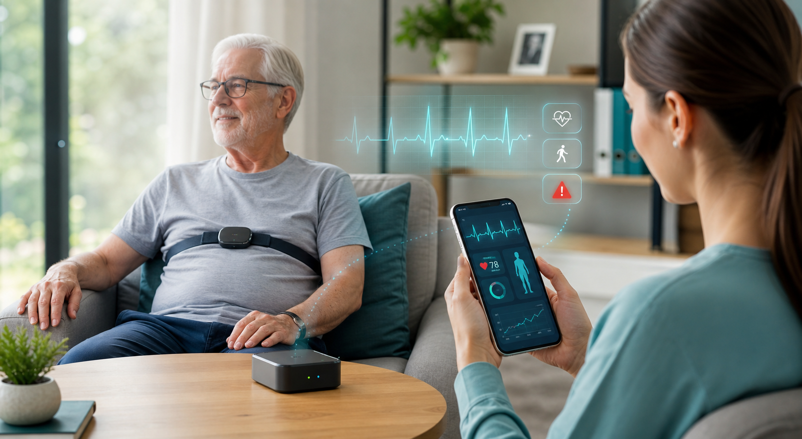

# Tài liệu bán hàng dự án Elderly Care Edge AI

Ngày cập nhật: 03/06/2026  
Định vị: hệ thống hỗ trợ theo dõi và cảnh báo sức khỏe người cao tuổi tại nhà, chưa phải thiết bị chẩn đoán y khoa độc lập.



## 1. Thông điệp bán hàng ngắn

Nếu gia đình cần theo dõi người cao tuổi tại nhà nhưng không muốn chỉ phụ thuộc vào đồng hồ thông minh hoặc nút bấm khẩn cấp, **Elderly Care Edge AI** là giải pháp ở giữa hai thế giới: có cảm biến ECG/ACC thật, xử lý AI tại nhà, cảnh báo realtime cho người chăm sóc, lưu lịch sử sức khỏe và vẫn tôn trọng quyền riêng tư vì dữ liệu thô được xử lý cục bộ trước.

Điểm đáng mua nhất: hệ thống không chỉ hỏi "có té ngã không", mà còn theo dõi **nhịp tim, nghi rung nhĩ, ngoại tâm thu PVC/PAC, stress sinh lý, chất lượng tín hiệu, trạng thái vận động, té ngã và baseline cá nhân** trong cùng một pipeline.

## 2. Sản phẩm là gì?

Elderly Care Edge AI gồm:

- **Polar H10**: cảm biến đeo ngực thu ECG/RR và ACC.
- **Raspberry Pi / edge gateway**: xử lý dữ liệu tại nhà, không cần gửi ECG thô lên cloud để mới có cảnh báo.
- **FastAPI dashboard + WebSocket/MQTT**: cập nhật realtime cho dashboard/app.
- **SQLite local + MongoDB sync tùy chọn**: lưu lịch sử tại nhà, đồng bộ cloud khi cần.
- **AI/rule engine**: phân loại nhịp, nghi AFib, AF episode/burden, PVC/PAC, stress, chất lượng tín hiệu, HR event, activity/fall và cảnh báo tổng hợp.

Luồng vận hành:

```text
Polar H10 ECG/ACC
-> Raspberry Pi Edge AI
-> signal quality + rhythm/PVC/stress/fall inference
-> local alert qua MQTT/WebSocket
-> dashboard/app caregiver
-> cloud sync metadata tùy chọn
```

## 3. Lý do nên mua

### 3.1. Cảnh báo nhanh tại nhà, không phụ thuộc hoàn toàn vào cloud

Nhiều giải pháp thị trường cần điện thoại, cloud hoặc tổng đài. Dự án này xử lý trên edge gateway, nghĩa là cảnh báo có thể phát ngay trong LAN qua MQTT/WebSocket. Khi mất Internet, hệ thống vẫn có thể thu ECG/ACC và ghi SQLite cục bộ; cloud sync chỉ là lớp lưu trữ/giám sát phụ.

### 3.2. Có ECG thực từ chest strap, không chỉ PPG ở cổ tay

Đồng hồ thông minh thường dùng PPG để theo dõi nền và ECG chỉ đo theo phiên ngắn khi người dùng chủ động đặt tay. Dự án dùng Polar H10, một chest strap được nghiên cứu rộng rãi cho RR/HRV. Nghiên cứu Gilgen-Ammann 2019 ghi nhận Polar H10 đạt chất lượng RR interval tổng thể 99,6% và duy trì 99,4% trong hoạt động cường độ cao.

### 3.3. Thiết kế đúng bài toán người cao tuổi

Người cao tuổi không chỉ gặp một rủi ro đơn lẻ. Hệ thống kết hợp:

- Nghi rung nhĩ/AFib và AF burden.
- Nhịp nhanh khi nghỉ, nhịp chậm.
- Té ngã: free-fall, impact, post-still.
- Stress sinh lý từ HRV.
- Chất lượng tín hiệu để tránh báo sai khi dây đeo lỏng hoặc nhiễu do vận động.
- Baseline cá nhân 7 ngày để so sánh theo từng người, không áp một ngưỡng cứng cho tất cả.

### 3.4. Giảm mệt mỏi vì cảnh báo giả

Pipeline không đẩy cảnh báo chỉ từ một model duy nhất. Nó kiểm tra chất lượng tín hiệu, hoạt động ACC và ngưỡng theo ngữ cảnh trước khi đưa ra mức `normal / medium / high / critical / unknown`. Ví dụ: HR tăng khi đang WALK/ACTIVE sẽ được hiểu khác HR tăng khi REST.

### 3.5. Dữ liệu đủ sâu cho người chăm sóc và bác sĩ

Dashboard/API cung cấp realtime, history, risk summary, daily health assessment, health report, events, ECG waveform và raw chunks. Với gia đình, điều này tạo cảm giác an tâm. Với bác sĩ, lịch sử có cấu trúc giúp trao đổi dễ hơn so với lời kể rời rạc.

## 4. Bằng chứng kỹ thuật nội bộ

Các số liệu dưới đây lấy từ artifacts hiện có trong repo tại `models/metrics`.

| Module | Dataset / đánh giá | Kết quả chính | Cách diễn giải khi bán |
|---|---:|---:|---|
| Rhythm feature model | 11.751 cửa sổ ECG, 30 giây/cửa sổ | Accuracy 74,07%; Macro F1 71,44%; AFib recall 66,05%; noise recall 85,54% | Đủ tốt cho prototype cảnh báo/sàng lọc; chưa tuyên bố chẩn đoán |
| AFDB long-term deployment config | 28.104 cửa sổ, 23 record AFDB | Precision 89,63%; Recall 74,03%; F1 81,09%; episode sensitivity 80,42%; episode precision 81,29% | Khi cảnh báo nghi AFib, độ tin cậy khá tốt; vẫn cần bác sĩ xác nhận |
| Stress model | WESAD, LOSO 15 subjects | LOSO accuracy mean 81,27%; macro F1 77,42%; stress F1 65,86% | Module phụ để theo dõi stress sinh lý, không phải chẩn đoán tâm lý |
| Ectopy PVC/PAC | MIT-BIH Arrhythmia | PVC recall 84,56%; PAC recall 17,74%; Macro F1 29,27% | PVC là tín hiệu hỗ trợ tốt hơn PAC; không nên bán như module chẩn đoán hoàn chỉnh |
| Fall detection | ACC rule-based | Chưa có dataset té ngã có nhãn trong repo để công bố accuracy | Nên bán là cơ chế cảnh báo té ngã rule-based cần validation thêm |


## 5. So sánh với thị trường hiện tại

Tính đến 03/06/2026, thị trường có vài nhóm chính:

| Nhóm / sản phẩm | Giá tham khảo | Làm tốt | Hạn chế so với Elderly Care Edge AI |
|---|---:|---|---|
| Apple Watch Series 11 | từ 399 USD | ECG một chuyển đạo, irregular rhythm notification, fall detection, ecosystem mạnh | ECG thường là đo chủ động; phụ thuộc iPhone/watchOS; không phải hệ thống edge AI riêng cho caregiver tại nhà |
| Samsung Galaxy Watch8 | từ khoảng 349,99 USD | ECG, irregular heart rhythm notification, fall detection/SOS, Android ecosystem | ECG/IHRN không thay thế chẩn đoán; phụ thuộc điện thoại Samsung/Android; không lưu pipeline ECG/ACC edge riêng |
| KardiaMobile 6L Max | 149 USD | 6-lead personal EKG, FDA-cleared, ghi EKG 30 giây | Không theo dõi té ngã/ACC, không continuous caregiver monitoring, không edge gateway |
| Medical Guardian MG Mini | từ 39,95 USD/tháng; fall detection +10 USD/tháng | Tổng đài 24/7, GPS, nút khẩn cấp, fall detection | Không phân tích ECG/rhythm/AF burden/stress; chi phí thuê bao liên tục |
| Bay Alarm Medical | từ 27,95 USD/tháng; fall detection thường +10 USD/tháng | Medical alert chuyên dụng, tổng đài, nút SOS | Tập trung emergency response, không phải hệ thống phân tích ECG/AI |
| Elderly Care Edge AI | BOM prototype tùy phần cứng; repo từng ước lượng khoảng 5,5 triệu VND | ECG/ACC + edge AI + dashboard/app + local storage + cloud sync tùy chọn + baseline cá nhân | Chưa có chứng nhận y tế; cần đóng gói UX, validation lâm sàng và quy trình support nếu thương mại hóa |

Kết luận thị trường: sản phẩm không nên cạnh tranh trực diện với Apple Watch ở lifestyle, cũng không nên cạnh tranh trực diện với Medical Guardian ở tổng đài emergency. Vị trí tốt nhất là **hệ thống theo dõi chuyên sâu tại nhà cho gia đình/caregiver**, nơi cần ECG/ACC liên tục, cảnh báo tại chỗ, dữ liệu lịch sử và khả năng tùy biến theo từng người.

## 6. Nền tảng khoa học và nghiên cứu liên quan

### 6.1. Nhu cầu thị trường/y tế

- WHO dự báo số người từ 60 tuổi trở lên sẽ tăng từ 1 tỷ năm 2020 lên 1,4 tỷ năm 2030 và 2,1 tỷ năm 2050.
- CDC ghi nhận hơn 1/4 người từ 65 tuổi trở lên bị ngã mỗi năm; té ngã gây khoảng 3 triệu lượt cấp cứu và khoảng 1 triệu ca nhập viện hằng năm tại Mỹ.
- CDC dự báo khoảng 12,1 triệu người tại Mỹ sẽ có AFib vào năm 2050.
- AHA nêu AFib có thể dẫn đến huyết khối, đột quỵ, suy tim và liên quan nguy cơ đột quỵ tăng khoảng 5 lần.

### 6.2. Cảm biến và dữ liệu

- Polar H10 có nghiên cứu validation RR interval chất lượng cao so với Holter/ECG, phù hợp cho HRV và theo dõi nhịp trong hoạt động.
- PhysioNet/CinC Challenge 2017 là benchmark phân loại ECG một chuyển đạo ngắn thành normal, AF, other rhythm, noisy; training set công khai 8.528 bản ghi.
- MIT-BIH AFDB dùng để đánh giá hành vi AF theo chuỗi dài, phù hợp cho AF episode và AF burden.
- WESAD là dataset stress/affect wearable, có 15 subject, thiết bị ngực và cổ tay, gồm ECG, ACC, EDA, EMG, respiration, temperature.

## 7. Cách nói với khách hàng

Thông điệp 30 giây:

> Đây là hệ thống giám sát sức khỏe người cao tuổi tại nhà dùng ECG thật từ Polar H10 và xử lý AI ngay trên Raspberry Pi. Khác với đồng hồ thông minh chỉ đo tiện ích hoặc nút SOS chỉ gọi cấp cứu, hệ thống này theo dõi nhịp tim, nghi rung nhĩ, té ngã, stress, chất lượng tín hiệu và xu hướng theo từng người. Khi có nguy cơ, người chăm sóc nhận cảnh báo realtime; khi cần xem lại, hệ thống có lịch sử và báo cáo sức khỏe. Sản phẩm hiện là công cụ hỗ trợ cảnh báo/sàng lọc, không thay thế bác sĩ, nhưng rất đáng giá cho gia đình muốn phát hiện sớm bất thường và chăm sóc chủ động hơn.

Thông điệp chốt sale:

> Anh/chị không mua một cái cảm biến. Anh/chị mua một lớp bảo vệ chủ động: thấy dấu hiệu sớm hơn, phản ứng nhanh hơn, và có dữ liệu rõ ràng hơn khi trao đổi với bác sĩ.

## 8. Gói đề xuất thương mại hóa

### Gói Home Prototype

- 1 Polar H10.
- 1 Raspberry Pi edge gateway đã cài service.
- Dashboard web local.
- Lưu SQLite local.
- Cảnh báo LAN qua WebSocket/MQTT.

Phù hợp: demo đồ án, pilot gia đình, thử nghiệm trong phòng lab.

### Gói Caregiver Plus

- Tất cả của Home Prototype.
- App caregiver.
- Cloud sync metadata.
- Event timeline.
- Daily health report.
- Personal baseline 7 ngày.

Phù hợp: gia đình có người chăm sóc từ xa.

### Gói Clinical Pilot

- Tất cả của Caregiver Plus.
- Quy trình gắn nhãn dữ liệu.
- Báo cáo PDF.
- Dashboard bác sĩ.
- Kế hoạch validation có chuyên gia y tế.

Phù hợp: thử nghiệm với phòng khám/viện dưỡng lão, chưa gọi là sản phẩm chẩn đoán.

## 9. Rủi ro cần nói thẳng

- ECG một chuyển đạo không thay thế ECG 12 chuyển đạo.
- Model AFib hiện còn bỏ sót một phần cửa sổ AFib; không nên dùng để tự quyết định điều trị.
- Fall detection rule-based cần dataset té ngã thực tế để công bố độ chính xác.
- PVC/PAC module còn yếu ở PAC và mixed ectopic.
- Trước khi bán thương mại như thiết bị y tế, cần validation lâm sàng, bảo mật, quy trình vận hành, hướng dẫn sử dụng và kiểm soát pháp lý.

Nói thẳng các giới hạn này không làm sản phẩm yếu đi; nó làm sản phẩm đáng tin hơn.

## 10. Nguồn tham khảo

- Apple Watch health/safety features: https://www.apple.com/watch/why-apple-watch/
- Apple Watch pricing: https://www.apple.com/shop/buy-watch/apple-watch
- Samsung Galaxy Watch8 health features: https://www.samsung.com/us/watches/galaxy-watch8/
- KardiaMobile 6L Max: https://kardia.com/products/kardiamobile-6l-max
- Medical Guardian MG Mini: https://www.medicalguardian.com/medical-alert-systems/gps-button-fall-detection
- Bay Alarm Medical pricing: https://www.bayalarmmedical.com/pricing/
- WHO Ageing and health: https://www.who.int/news-room/fact-sheets/detail/ageing-and-health
- CDC Facts About Falls: https://www.cdc.gov/falls/data-research/facts-stats/
- CDC About Atrial Fibrillation: https://www.cdc.gov/heart-disease/about/atrial-fibrillation.html
- AHA What is Atrial Fibrillation: https://www.heart.org/en/health-topics/atrial-fibrillation/what-is-atrial-fibrillation-afib-or-af
- Gilgen-Ammann et al. 2019, Polar H10 RR interval validation: https://pubmed.ncbi.nlm.nih.gov/31004219/
- Schaffarczyk et al. 2022, Polar H10 HRV validity: https://pubmed.ncbi.nlm.nih.gov/36081005/
- PhysioNet/CinC Challenge 2017: https://physionet.org/content/challenge-2017/
- MIT-BIH AFDB: https://physionet.org/content/afdb/1.0.0/
- WESAD UCI: https://archive.ics.uci.edu/dataset/465/wesad+wearable+stress+and+affect+detection
