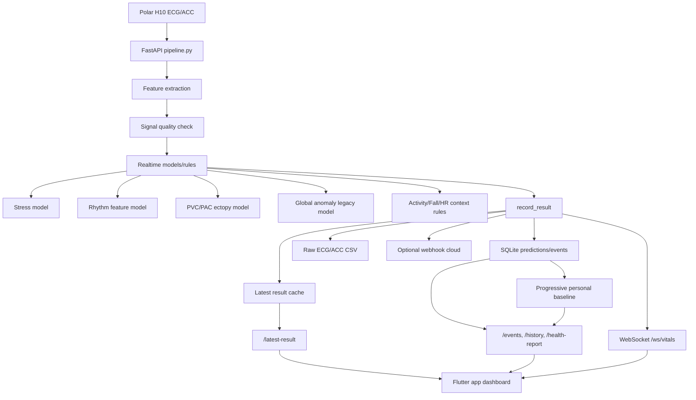

# Van Hanh He Thong App - Model - Cloud

Tai lieu nay mo ta luong van hanh hien tai cua he thong sau khi da ket noi app Flutter `D:\DATN\app` voi ECG pipeline `D:\DATN\elderly_care-amine\elderly_care-amine`.

Pham vi hien tai:

- Thu ECG/ACC tu Polar H10.
- Xu ly realtime qua FastAPI backend.
- Chay cac model/rule: stress, rhythm, PVC/PAC, global anomaly legacy, signal quality, activity/fall, daily/long-term assessment.
- Anomaly calibration ca nhan hien tat mac dinh; realtime dung global anomaly legacy co signal-quality gate.
- Hieu chinh personal baseline luy tien toi da 7 ngay cho tung patient.
- Luu du lieu vao SQLite va CSV raw ECG/ACC.
- App Flutter hien thi output cho nguoi deo va nguoi giam sat.
- Canh bao realtime qua polling `/events`, WebSocket `/ws/vitals`, va webhook cloud tuy chon.

Luu y y khoa: output cua he thong la theo doi, canh bao va nghi ngo nguy co. Khong duoc trinh bay nhu chan doan y khoa chac chan.

## 1. Luong Hoat Dong Tong The



## 2. Cac Tang Thoi Gian Cua Bao Cao

He thong khong chi dua ra mot ket qua tai mot thoi diem. Output duoc tach thanh 3 tang:

| Tang | Khoang thoi gian | Endpoint | Muc dich |
|---|---:|---|---|
| Realtime | window moi nhat, mac dinh 30 giay ECG | `/latest-result` va layer `realtime` trong `/health-report` | Hien thi trang thai hien tai, HR, rhythm, PVC/PAC, fall, signal quality |
| Daily | rolling 24 gio | `/daily-health-assessment`, layer `daily` trong `/health-report` | Tong hop nguy co/nghi ngo trong ngay: AFib pattern, HR events, anomaly trend, poor signal |
| Long-term | mac dinh 7 ngay | layer `long_term` trong `/health-report` | Xem xu huong lap lai nhieu ngay, phuc vu bao cao suc khoe dai han |

Ngoai 3 tang tren, `/health-report` con co truong `personal_baseline`. Truong nay so sanh du lieu gan day voi baseline ca nhan cua tung patient, vi du delta HR trung binh, delta HR khi nghi, delta AF suspicion, delta anomaly va delta PVC/PAC.

## 3. Backend Pipeline Hien Tai

File chinh:

- `src/api/pipeline.py`

Endpoint chinh:

| Endpoint | Chuc nang | App dang dung |
|---|---|---|
| `GET /health` | Kiem tra backend/model da load chua | Co the dung de debug |
| `GET /latest-result` | Lay prediction moi nhat | Dashboard realtime |
| `GET /health-report` | Bao cao 3 tang thoi gian | Dashboard/report |
| `GET /events` | Timeline canh bao | Alert Center, polling 2 giay |
| `GET /history` | Lich su prediction | History charts |
| `GET /latest-ecg` | ECG waveform moi nhat | Dashboard web backend |
| `POST /polar/start` | Bat Polar collector | Dashboard backend |
| `POST /polar/stop` | Tat Polar collector | Dashboard backend |
| `POST /personal-baseline/update-progressive` | Cap nhat baseline ca nhan luy tien toi da 7 ngay | Dashboard backend/manual operation |
| `GET /personal-baseline/status` | Xem trang thai baseline ca nhan | Debug/operation |
| `WS /ws/vitals` | Push latest result qua WebSocket | App da cau hinh, HTTP polling van la fallback chinh |

## 4. App Flutter Hien Tai

Folder app:

- `D:\DATN\app`
- GitHub: `https://github.com/ducchinhsero/Elderly-Care`

File ket noi API:

- `lib/core/services/api_service.dart`
- `lib/core/providers/vitals_provider.dart`
- `lib/core/providers/alerts_provider.dart`
- `lib/core/models/vitals_model.dart`
- `lib/core/models/health_report_model.dart`
- `lib/core/models/alert_model.dart`

Man hinh hien thi:

- `lib/features/dashboard/dashboard_screen.dart`
- `lib/features/report/health_report_screen.dart`
- `lib/features/alerts/alert_center_screen.dart`
- `lib/features/history/history_screen.dart`

Nguon du lieu app:

- Neu `demo_mode = false`: app goi backend FastAPI.
- Neu `demo_mode = true`: app dung mock data noi bo.

Mac dinh moi da doi:

- `demo_mode = false`
- `gateway_ip = 127.0.0.1`
- `apiBaseUrl = http://127.0.0.1:8000` khi chay app tren cung may voi backend.

Neu chay tren dien thoai/Raspberry/PC khac, khong dung `127.0.0.1`. Phai dat gateway IP thanh IP cua may dang chay backend, vi du:

```text
http://192.168.1.23:8000
```

## 5. Cloud Dang Duoc Su Dung La Gi?

Hien tai chua co cloud provider co dinh nao duoc deploy san.

He thong dang ho tro 3 kieu tich hop cloud/tro ly tu xa:

1. Webhook cloud tuy chon
   - Bien moi truong: `ALERT_WEBHOOK_URL`
   - Backend se POST event canh bao len URL nay ngay khi co event tuong ung.
   - Co the noi vao Cloud Function, VPS, backend app, Telegram bridge, Discord bridge, Firebase Function, hoac server rieng.

2. WebSocket `/ws/vitals`
   - Neu backend duoc deploy len cloud/VPS, app caregiver co the ket noi WebSocket de nhan vitals.
   - Hien tai app van co HTTP polling fallback de dam bao chay on dinh.

3. MongoDB sync tuy chon
   - Code co module `src/storage/mongodb_sync.py`.
   - Chi hoat dong khi cau hinh MongoDB URI.
   - Hien chua bat mac dinh.

Ket luan: cloud hien tai la "interface san sang ket noi", chua phai mot cloud service da duoc cau hinh cu the. Cach nhanh nhat de demo canh bao cloud la dung `ALERT_WEBHOOK_URL`.

## 6. Cach Chay Demo Local

### 6.1. Chay backend pipeline

Tai thu muc:

```powershell
cd D:\DATN\elderly_care-amine\elderly_care-amine
.\.venv\Scripts\Activate.ps1
uvicorn src.api.pipeline:app --host 127.0.0.1 --port 8000 --reload
```

Mo dashboard backend:

```text
http://127.0.0.1:8000/dashboard
```

Kiem tra backend:

```powershell
Invoke-RestMethod http://127.0.0.1:8000/health | ConvertTo-Json -Depth 5
```

Can thay cac truong quan trong:

- `status = ok`
- `rhythm_model_loaded = true`
- `rhythm_model_source = rhythm_feature_model`
- `ectopy_model_loaded = true`
- `sklearn_version = 1.8.0`
- `sklearn_version_ok = true`
- `anomaly_enabled = true`
- `anomaly_calibration_enabled = false`
- `anomaly_runtime_status = enabled_global_legacy`

### 6.2. Bat Polar collector

Tu dashboard backend bam Start Polar, hoac chay:

```powershell
Invoke-RestMethod -Method Post `
  -Uri http://127.0.0.1:8000/polar/start `
  -ContentType "application/json" `
  -Body '{"address":"24:AC:AC:13:EB:86","chunk_seconds":30}'
```

Dung Polar:

```powershell
Invoke-RestMethod -Method Post http://127.0.0.1:8000/polar/stop
```

### 6.3. Chay app Flutter

Tai thu muc:

```powershell
cd D:\DATN\app
flutter pub get
flutter run -d windows
```

Neu chay web:

```powershell
flutter run -d chrome
```

Luu y: loi cu `flutter build web` do Isar generated integer ID vuot gioi han JavaScript da duoc xu ly bang viec chuyen profile repository sang Hive. `flutter test` va `flutter build web --no-wasm-dry-run` da pass sau lan sua gan nhat.

## 7. Cach Kiem Tra Tung Output

### 7.1. Latest result

```powershell
Invoke-RestMethod http://127.0.0.1:8000/latest-result | ConvertTo-Json -Depth 8
```

Kiem tra:

- `latest_result.patient_id`
- `latest_result.heart_rate_bpm`
- `latest_result.rhythm.label`
- `latest_result.rhythm.possible_afib_probability`
- `latest_result.ectopy.label`
- `latest_result.signal_quality.label`
- `latest_result.risk.level`
- `latest_result.alert_level`

### 7.2. Bao cao 3 tang

```powershell
Invoke-RestMethod "http://127.0.0.1:8000/health-report?patient_id=polar_h10&daily_hours=24&long_term_days=7" |
  ConvertTo-Json -Depth 8
```

Kiem tra:

- `layers.realtime`
- `layers.daily`
- `layers.long_term`
- `overall.level`
- `personal_baseline.calibration.status`
- `personal_baseline.comparisons`

### 7.3. Progressive personal baseline 7 ngay

Cap nhat baseline ca nhan luy tien:

```powershell
Invoke-RestMethod -Method Post `
  -Uri http://127.0.0.1:8000/personal-baseline/update-progressive `
  -ContentType "application/json" `
  -Body '{"patient_id":"polar_h10","target_days":7,"min_predictions":20,"include_alert_windows":false}' |
  ConvertTo-Json -Depth 8
```

Kiem tra trang thai:

```powershell
Invoke-RestMethod "http://127.0.0.1:8000/personal-baseline/status?patient_id=polar_h10" |
  ConvertTo-Json -Depth 8
```

Y nghia trang thai:

| Status | Y nghia |
|---|---|
| `not_ready` | Chua du prediction tin cay de dung lam baseline. |
| `warming_up` | Da co baseline tam thoi, nhung chua du 7 ngay. Chi nen tham khao. |
| `ready` | Du 7 ngay va du prediction tin cay, co the dung de so sanh ca nhan hoa. |

Khuyen nghi van hanh: moi ngay goi endpoint update mot lan. Tren Raspberry co the dung cron/systemd timer; tren Windows co the dung Task Scheduler. Sau ngay thu 7, tiep tuc update theo rolling 7 ngay de baseline theo sat nguoi dung nhung khong hoc qua nhanh theo bat thuong ngan han.

### 7.4. Event timeline

```powershell
Invoke-RestMethod "http://127.0.0.1:8000/events?patient_id=polar_h10&days=7&limit=20" |
  ConvertTo-Json -Depth 6
```

Kiem tra cac event:

- `af_suspicion`
- `ectopy_suspicion`
- `tachycardia`
- `bradycardia`
- `fall_candidate`
- `poor_signal`

### 7.5. App Flutter

Tren app:

1. Dam bao Settings dang tat Demo Mode.
2. Gateway IP:
   - Neu app va backend cung may: `127.0.0.1`
   - Neu app tren dien thoai: IP LAN cua may/Raspberry chay backend.
3. Vao Dashboard:
   - Card HR cap nhat theo `/latest-result`.
   - Card "Ket qua phan tich tu model" hien rhythm, AFib, PVC/PAC, signal quality.
   - Card "Bao cao suc khoe theo thoi gian" hien 3 tang.
4. Vao Alerts:
   - Danh sach lay tu `/events`.
   - Polling moi 2 giay.

## 8. Kiem Tra Webhook Cloud

### 8.1. Cau hinh webhook

Vi du dung webhook endpoint rieng:

```powershell
$env:ALERT_WEBHOOK_URL="https://your-cloud-endpoint.example.com/alerts"
$env:ALERT_WEBHOOK_LEVELS="medium,high,critical"
uvicorn src.api.pipeline:app --host 0.0.0.0 --port 8000 --reload
```

Kiem tra:

```powershell
Invoke-RestMethod http://127.0.0.1:8000/health | ConvertTo-Json -Depth 5
```

Can thay:

- `alert_webhook_configured = true`
- `alert_webhook_levels = ["critical", "high", "medium"]`

### 8.2. Payload webhook

Backend gui JSON dang:

```json
{
  "type": "elderly_care_alert",
  "patient_id": "polar_h10",
  "timestamp": "...",
  "alert_level": "medium",
  "message": "...",
  "heart_rate_bpm": 102.18,
  "events": [],
  "latest_result": {}
}
```

Webhook chi nen dung de gui canh bao len cloud/server khac. Du lieu day du va lich su van nam trong SQLite local, tru khi bat MongoDB sync.

## 9. Van Hanh Tren Raspberry

Khi chuyen sang Raspberry:

1. Backend chay tren Raspberry:

```powershell
uvicorn src.api.pipeline:app --host 0.0.0.0 --port 8000
```

2. App tren dien thoai/PC dat gateway IP thanh IP LAN cua Raspberry.

3. Neu can caregiver remote ngoai mang LAN:
   - Dat backend sau domain/VPS/reverse proxy, hoac
   - Dung webhook de day canh bao len cloud, hoac
   - Dong bo MongoDB va xay cloud API rieng cho caregiver.

4. Mo firewall port 8000 neu test trong LAN.

5. Khong nen expose truc tiep API len internet ma khong co HTTPS/authentication.

### 9.1. Bao ve API truoc khi mo ngoai LAN

Khuyen nghi demo/caregiver remote: dung VPN/Tailscale truoc, khong public truc tiep port 8000.

Neu bat buoc expose API, bat API key trong `.env`:

```env
API_AUTH_ENABLED=1
API_KEY=<secret>
API_PUBLIC_PATHS=/health,/dashboard
ALLOWED_ORIGINS=https://your-app-domain.example
```

Client phai gui header:

```http
X-API-Key: <secret>
```

Endpoint can bao ve bat buoc:

- `/polar/start`, `/polar/stop`
- `/storage/*`
- `/events/rebuild`
- `/personal-baseline/*`
- `/guided-baseline/*`

Khong commit `.env`, MongoDB URI, MQTT password, API key.

## 10. Kiem Thu Sau Moi Lan Sua

Backend:

```powershell
cd D:\DATN\elderly_care-amine\elderly_care-amine
.\.venv\Scripts\python.exe -m py_compile src\api\pipeline.py
.\.venv\Scripts\python.exe -m unittest discover -s tests
```

App:

```powershell
cd D:\DATN\app
dart analyze lib\core\models\vitals_model.dart lib\core\models\health_report_model.dart lib\core\providers\vitals_provider.dart lib\core\providers\alerts_provider.dart lib\features\dashboard\dashboard_screen.dart
flutter test
```

Ket qua hien tai da kiem tra:

- Backend sau progressive baseline: `60 tests OK`
- Flutter: `7 tests OK`
- Dart analyze tren cac file tich hop: khong co error; con mot so goi y `const`.

## 11. Nhung Viec Chua Nen Hieu Sai

- `health-report` khong phai chan doan benh.
- `ectopy` hien la warning/suspicion, chua du manh de ket luan PVC/PAC y khoa.
- `stress` co metrics tren WESAD, nhung van can validation voi Polar thuc te.
- Cloud hien tai la tuy chon webhook/WebSocket/MongoDB sync, chua phai mot backend cloud hoan chinh co auth/user management.

## 12. De Xuat Buoc Tiep Theo

1. Chon cloud target:
   - VPS/FastAPI cloud.
   - Firebase Cloud Functions + FCM.
   - MongoDB Atlas + backend API.
   - Telegram/Zalo/Discord webhook cho demo canh bao.

2. Them authentication:
   - API key/toy token cho demo.
   - JWT/user pairing cho ban san pham.

3. Them notification that tren app:
   - Local notification khi app dang mo.
   - FCM khi caregiver o xa.

4. Dong bo long-term report len cloud:
   - predictions/events summary.
   - daily health assessment.
   - raw ECG chi nen upload co chon loc vi dung luong lon va nhay cam.
