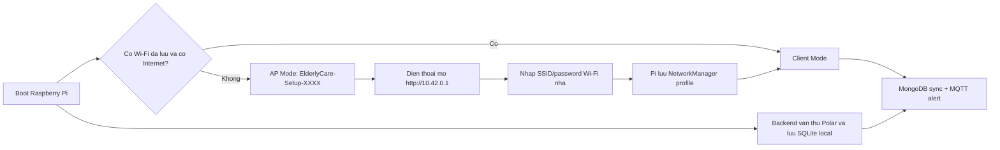

# Production Wi-Fi Provisioning cho Raspberry Pi

Ngay cap nhat: 2026-06-01

Tai lieu nay mo ta co che dua Raspberry Pi sang nha nguoi dung moi ma khong can SSH/VNC de nhap Wi-Fi thu cong.

## Muc tieu

Raspberry Pi hoat dong theo mo hinh offline-first:



Khi chua co Internet, backend van thu ECG/ACC va ghi vao SQLite local. MongoDB sync va MQTT cloud chi tiep tuc khi Pi ket noi duoc Wi-Fi.

## Thanh phan moi

- `src.network.provisioning`: service captive portal va NetworkManager controller.
- `elderly-care-wifi-provisioner.service`: systemd service chay bang `root` de quan ly Wi-Fi.
- `network_status.json`: file trang thai de backend `/health` doc va hien thi.

Backend FastAPI khong duoc cap quyen root. Backend chi doc trang thai provisioning, con viec bat/tat AP va luu Wi-Fi do service rieng xu ly.

## Cai dat tren Raspberry Pi

### 1. Cai goi he thong

```bash
sudo apt update
sudo apt install -y network-manager dnsmasq-base hostapd wireless-tools
sudo systemctl enable --now NetworkManager
sudo systemctl disable --now hostapd || true
```

Neu Raspberry Pi OS dang dung `dhcpcd` hoac cau hinh network cu, can chuyen sang NetworkManager truoc khi dung provisioning production.

Ghi chu: service cua du an dieu khien AP qua NetworkManager. `hostapd`/`dnsmasq-base` la thanh phan he thong phuc vu AP/DHCP, khong chay RaspAP va khong bat standalone `hostapd.service`.

### 2. Cau hinh `.env`

Them hoac giu cac bien sau trong `/home/<user>/elderly_care/.env`:

```env
WIFI_INTERFACE=wlan0
WIFI_AP_SSID_PREFIX=ElderlyCare-Setup
WIFI_AP_PASSWORD=<mat-khau-setup-it-nhat-8-ky-tu>
WIFI_SETUP_IP=10.42.0.1
WIFI_PORTAL_HOST=0.0.0.0
WIFI_PORTAL_PORT=80
WIFI_MONITOR_INTERVAL_SECONDS=60
```

Neu `WIFI_AP_PASSWORD` de trong, service se tu sinh password va luu trong:

```text
<ECG_DATA_DIR>/wifi_provisioning/ap_password
```

Nen dat password rieng cho tung thiet bi va dan tren vo hop/tem QR.

### 3. Cai systemd service

Copy file mau:

```bash
sudo cp /home/<user>/elderly_care/deploy/systemd/elderly-care-wifi-provisioner.service \
  /etc/systemd/system/elderly-care-wifi-provisioner.service
```

Sua username/path neu khac `elcaprj`:

```bash
sudo nano /etc/systemd/system/elderly-care-wifi-provisioner.service
```

Can dung dung:

```ini
WorkingDirectory=/home/<user>/elderly_care
EnvironmentFile=-/home/<user>/elderly_care/.env
ExecStart=/home/<user>/elderly_care/.venv/bin/python -m src.network.provisioning
```

Enable service:

```bash
sudo systemctl daemon-reload
sudo systemctl enable elderly-care-wifi-provisioner
sudo systemctl start elderly-care-wifi-provisioner
sudo systemctl status elderly-care-wifi-provisioner --no-pager
```

Backend `elderly-care.service` van chay rieng nhu cu. Khong nen cho backend phu thuoc Internet moi start, vi backend can tiep tuc luu SQLite khi offline.

## Cach dung lan dau tai nha nguoi dung

1. Cap nguon Raspberry Pi.
2. Neu Pi khong ket noi duoc Wi-Fi cu, dien thoai se thay Wi-Fi `ElderlyCare-Setup-XXXX`.
3. Ket noi vao Wi-Fi setup bang password da dan tren thiet bi.
4. Mo:

```text
http://10.42.0.1
```

5. Chon Wi-Fi nha, nhap password, bam ket noi.
6. Wi-Fi setup se bien mat neu ket noi thanh cong.
7. Dien thoai quay lai Wi-Fi nha va mo app voi backend URL:

```text
http://<ip-cua-raspberry-pi>:8000
```

## Kiem tra trang thai

Tren Pi:

```bash
source /home/<user>/elderly_care/.venv/bin/activate
python -m src.network.provisioning --status
python -m src.network.provisioning --scan
```

Qua backend:

```bash
curl http://127.0.0.1:8000/health
```

Trong response se co:

```json
{
  "network_provisioning": {
    "mode": "client",
    "connected_ssid": "HomeWiFi",
    "internet_reachable": true
  }
}
```

Gia tri `mode`:

- `client`: Pi da vao Wi-Fi nha.
- `ap`: Pi dang phat Wi-Fi setup.
- `offline`: Pi co the dang ket noi Wi-Fi nhung chua co Internet, hoac chua ket noi duoc.
- `connecting`: dang thu ket noi Wi-Fi moi.
- `unknown`: chua co file trang thai hoac doc loi.

## Bat lai setup mode

Tao trigger file roi restart service:

```bash
touch /home/<user>/elderly_care/data/wifi_setup_mode
sudo systemctl restart elderly-care-wifi-provisioner
```

Service se bat AP setup o lan chay tiep theo.

## Test production

- Boot Pi o noi khong co Wi-Fi da luu: phai thay AP setup.
- Nhap sai password: AP van ton tai, portal tra loi co loi.
- Nhap dung password: AP tat, Pi vao Wi-Fi nha.
- Reboot: Pi tu vao Wi-Fi nha, khong phat AP.
- Rut Internet/router mat mang: backend van luu SQLite, MongoDB sync retry.
- Co mang lai: `/storage/sync-scheduler/status` va MongoDB sync hoat dong tiep.

## Gioi han v1

- Portal HTTP local trong mang setup rieng, chua dung HTTPS.
- Chua co nut vat ly tren vo thiet bi; setup mode dung trigger file/systemd.
- Flutter app da co man "Thiet lap Wi-Fi Raspberry" goi portal API `10.42.0.1`; browser portal van duoc giu de fallback khi app khong mo duoc.
